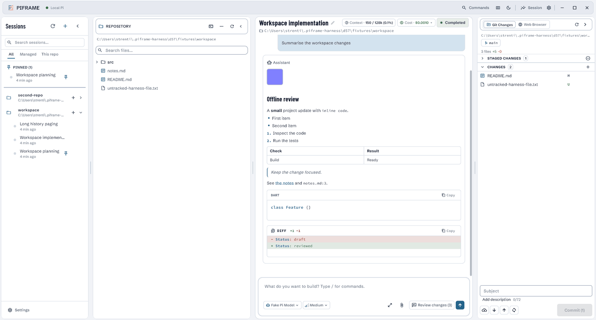
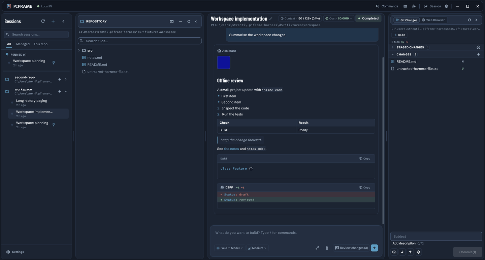

# PiFrame design system

This file describes the PiFrame app as it ships today, in Google's DESIGN.md format: the tokens are in the front
matter above, and the sections below follow the format's order, followed by PiFrame's own sections (interaction model,
accessibility, state matrix, anti-slop gate, definition of done). The terms come from [GLOSSARY.md](GLOSSARY.md).

The source of truth for every value is the shipped theme: [themes/piframe-light.json](themes/piframe-light.json),
[themes/piframe-dark.json](themes/piframe-dark.json) and the theme package in
[packages/pi_frame_theme](packages/pi_frame_theme). The gate checks this file against them (`DESIGN.md tokens match the
theme`) and runs Google's linter on it (`DESIGN.md lint`); change the theme first, then this file.

Every screenshot here is a real capture of the running app, taken with the UI harness (fake Pi, seeded fixtures) and
kept in [docs/design/screens](docs/design/screens). They are captured on purpose and never regenerated by tests.

## Overview

PiFrame is a workbench, not a chat toy. One window holds everything a developer needs to drive the Pi coding agent:
the sessions rail on the left, the chat pane in the middle, and companion panes (repository, Git Changes, web browser)
beside it, with the Agents pane appearing when a session has subagents, workflows or a side conversation. The look is
calm, dense and technical: flat surfaces separated by hairline borders, one blue accent, condensed display headings,
monospace wherever the content is code, paths or numbers.

The two themes share everything except colour: the same layout, type, radii, spacing and motion. Settings →
Appearance picks System, Light or Dark, and the title bar toggles between them; neither theme is an afterthought. Users can add their own themes as JSON files in
`~/.piframe/themes/` (schema: [themes/theme.schema.json](themes/theme.schema.json)) or import a VS Code theme.

The emotional target is "a tool that gets out of the way": the agent's work is the content, and the chrome stays quiet
until something needs the user (a UI request, an error, a finished run).

**Who it is for.** Pi users who work in a terminal coding harness and want a desktop or web window to manage
sessions, follow the agent and review its changes; the design balances fast paths for frequent users with visible,
labelled controls for occasional ones. Windows, macOS and the web build have equal priority (Linux builds too); iOS and
Android apps are out of scope, and the web build on a phone is for remote access.

**What the design must never break** (each has an ADR):

- Pi owns session history: the app shows and drives sessions, but the session files stay Pi's (ADR 0021).
- Agent work outlives the window: closing or losing the app never stops a run; reconnecting replays it (ADR 0006,
  0008).
- Everything stays local: the daemon listens on `127.0.0.1` with a token, and the app sends no telemetry (ADR 0011,
  0016).
- The layout is one window of related work areas tied to the active session (ADR 0022), in PiFrame's own two themes
  and one surface grammar (ADR 0023).

## Colors

Colour is semantic. Each token has one job, and the light and dark values are tuned separately for contrast instead of
being inverted. Mode-dependent tokens live under `colors.light` and `colors.dark`; the top-level `primary` is an alias
of the light accent for tools that need one brand colour.

- **Primary (accent)** — light `#24638a`, dark `#5f9fc5`. Primary buttons, selected tabs, links, focus rings, the
  `info` signal. Text on it uses `on-primary`. It is the only saturated colour that is not a status.
- **Surfaces** — `background` is the window behind the panes, `chassis` the title bar and frame, `surface` the panes
  and cards, `surface-elevated` menus, dialogs and code blocks, `display-surface` with `display-text` the dense
  read-outs. In light, panes are white on a cool grey background; in dark, panes are a slate one step above the
  background.
- **Text** — `text-primary` for content, `text-secondary` for labels and metadata, `text-muted` for hints, timestamps
  and placeholders. Never use a fourth grey.
- **Lines** — `border` for hairlines between rows and panes, `border-strong` for dividers that must read at a glance,
  `input-border` for text field outlines, `focus-ring` for keyboard focus. `input-border` and `focus-ring` keep at
  least 3:1 contrast against `surface` ([docs/theming.md](docs/theming.md)).
- **Status** — `success`, `warning`, `danger`, `info` for general outcomes; the `agent-*` set for what the agent is
  doing (working, retrying, compacting, settled, awaiting user, error); `thinking` for reasoning. `signal-warning` and
  `signal-danger` are the same hues for small signals on the chassis.
- **Conversation** — `user-bubble` fills the user's messages so they read apart from the assistant's plain cards.
- **Diff and code** — `diff-added-*`, `diff-removed-*` (a 15% tint behind the line and the full colour for its text),
  `diff-context-fg`, and the ten `syntax-*` colours for highlighted code.
- **Overlay** — `overlay` is the translucent scrim behind modal surfaces such as the command palette.

Status is never shown by colour alone: a status tag is a coloured dot plus a word, a failed message adds an error line
and a retry icon (see the state matrix).

## Typography

Three families, bundled with the app, each with a fixed role:

- **Schibsted Grotesk** (`SchibstedGrotesk`) for all UI text: the nine roles below.
- **Barlow Condensed** (`BarlowCondensed`, `brand-heading`) only for the brand and pane headings: the session title,
  "Sessions", "Resume your work", "PiFrame Settings". Never for body text or buttons.
- **Source Code Pro** (`SourceCodePro`) for code, diffs, paths, branch names, token counts and timers. File and
  folder names in the repository tree are UI text in Schibsted Grotesk; only the full root path above the tree is
  mono.

| Role | Size / line height | Weight | Use |
| --- | --- | --- | --- |
| `display` | 28/32 | 600 | Rare large numbers and empty-state titles |
| `heading` | 20/26 | 600 | Dialog and page headings |
| `title` | 16/22 | 600 | Section titles inside a pane |
| `body-large` | 14/20 | 400 | Default reading text, transcript messages |
| `body` | 13/20 | 400 | Dense lists and secondary text |
| `label` | 12/16 | 500 | Buttons, chips, tabs, status tags |
| `caption` | 11/16 | 400 | Timestamps and metadata; the smallest size |
| `mono-body` | 13/20 | 400 | Code blocks and diff bodies |
| `mono` | 12/18 | 400 | Paths and short inline code |

Sentence case everywhere. Uppercase with letter spacing is reserved for small group labels such as "PINNED", "STAGED
CHANGES" and the code-block language tag.

## Layout

The window is one row of panes under a 40 px title bar ([welcome, dark](docs/design/screens/welcome-dark.png);
[welcome, light](docs/design/screens/welcome-light.png)):

1. **Sessions rail** — 280 px by default, resizable from 220 to 560 px. It is docked from a window width of 1560 px;
   narrower windows show it as a drawer. Collapsed, it becomes a 40 px strip with a vertical "SESSIONS" label
   ([review, dark](docs/design/screens/review-diff-dark.png)).
2. **Workspace panel** — the chat pane (never narrower than 420 px) plus its companion panes. A companion pane that
   would get less than 160 px collapses to its tab. Panes are separated by 8 px drag handles.
3. **Agents pane** — opens beside the chat pane when the session has subagents, workflows, a side conversation or
   tasks ([active run with subagents](docs/design/screens/run-active-agents-light.png)).

The work panes adapt to the window width (ADR 0022):

- **1440 px and wider** — every visible pane side by side.
- **900 to 1439 px** — the chat pane plus one companion pane; the other companions become tabs in its header.
- **Below 900 px** — one pane at a time, chosen from a Chat / Files / Git Changes selector, chat first; the sessions
  rail is a drawer.

Hiding or switching a pane keeps its state: scroll position, selected file and unsaved editor text. The repository
and Git Changes panes always show the active session's working folder; selecting another session switches them too.

Spacing uses a 4 px base: `x1` 4, `x2` 8, `x3` 12, `x4` 16, `x6` 24, `x8` 32, and `x12` 48 for the page gutter of
wide layouts such as the welcome view. Lists use 28 px rows; form rows are 40 px; pane headers are 40 px. Content
inside a pane starts 12–16 px from its edge. Wide reading content (settings, the welcome view) is centred in a column
of about 700 px instead of stretching ([settings](docs/design/screens/settings-appearance-dark.png)).

## Elevation & Depth

PiFrame is flat. Hierarchy comes from tone and hairlines, not shadows:

- `background` → `surface` → `surface-elevated` is the whole depth scale. Panes sit on the background as rounded
  `surface` cards with a `border` outline; code blocks, menus and dialogs use `surface-elevated`.
- Modal layers (command palette, dialogs) dim the window with the `overlay` scrim and sit centred above it
  ([command palette](docs/design/screens/command-palette-light.png)).
- Shadows are rare and quiet, never the main source of hierarchy: tone and hairlines come first. The shadows in the
  app today are kept: a small soft shadow under the menus that float over the composer without a scrim (slash menu,
  `@` file menu, attachment preview), the one-shot glows of the command chip and the chat drop target, and a faint
  shadow on the task notification card and the todo panel. The design direction is still open, so new UI may use a
  shadow when it is subtle, purposeful (it lifts something that floats or needs attention) and reviewed by the
  maintainer; panes stay flat. Floating layers otherwise separate from the content by the scrim, their
  surface-elevated fill and their border outline.

## Shapes

Corners are soft but small: `sm` 6 px for buttons, chips, inputs and list highlights; `md` 10 px for cards, code
blocks and dialogs; `lg` 14 px for panes and message bubbles; `pill` 999 px for segmented controls, status pills and
toggles. Nested shapes step down one level (a code block inside a message card uses `sm` or `md`, never `lg`).
Icons are 16 px line icons (14 px in dense chips and toolbars, 20 px for the few large ones) inside a 28 × 28 px hit
target.

## Motion

Motion is quick and functional: it confirms an action or shows where something came from, and it never loops for
decoration. Durations and curves come from `FrameMotionTokens` in the theme package; the theme files override `micro`
(`fast`) and `panel` (`normal`).

The motion tokens are this table rather than front matter because the pinned linter (`@google/design.md` 0.4.0) does
not yet accept the spec's `motion` group; the token match reads the table.

| Token | Duration | Timing function | Used for |
| --- | --- | --- | --- |
| `instant` | 0ms |  | Changes that must not animate |
| `micro` | 120ms |  | Hover, press and colour changes |
| `small` | 160ms |  | Expand and collapse, chips, small state changes |
| `panel` | 240ms |  | Panes, side panel and entrances |
| `small-exit` | 120ms |  | Exit of menus and chips |
| `panel-exit` | 180ms |  | Exit of panes and side panels |
| `dialog` | 180ms |  | Dialog entrance |
| `dialog-exit` | 120ms |  | Dialog exit |
| `first-run` | 300ms |  | First-run and onboarding transitions |
| `stagger` | 100ms |  | Delay between items of a staggered list |
| `cross-fade` | 120ms |  | Cross-fade that replaces movement under reduced motion |
| `debounce` | 300ms |  | Wait after the last keystroke before a field re-validates |
| `tooltip-wait` | 300ms |  | Hover wait before a tooltip opens |
| `pulse-loop` | 1400ms |  | Startup overlay, working dot on running sessions, subagent orbit |
| `shimmer-loop` | 3600ms |  | The animated border of the composer while a run is active |
| `launch-reveal` | 620ms |  | Reveal of the launch surface |
| `enter-curve` |  | `cubic-bezier(0.23, 1, 0.32, 1)` | Ease-out with a fast start: most changes |
| `panel-curve` |  | `cubic-bezier(0.32, 0.72, 0, 1)` | Ease-out with a soft landing: large surfaces |

Exits are faster than entrances. Pressed controls scale to 0.97; disabled controls never scale. Under "Reduce
animations" (Settings → Appearance, or the operating system setting) movement becomes a cross-fade of at most 150 ms
and the three loops stop. Keyboard activation never waits for an animation.

Motion may confirm a mode change that matters for safety. The command chip is the reference case: it pops in and
fades a one-shot accent glow over `panel`, so the user sees that the input became a command; the slash menu fades
and slides in over `small` and its highlight moves over `micro`. The startup overlay plays on the first run and,
when "Startup animation" is on in Settings (off by default), on every launch; other launches use `launch-reveal`,
which the first input finishes at once.

## Voice & Content Strategy

- **Tone:** plain, precise, calm. Say what happened and what to do next; no exclamation marks, no jokes in errors.
- **Capitalization:** sentence case for headings, buttons, tabs and menu items ("New session", "Browse sessions",
  "Review changes"). Small uppercase labels only for group headings.
- **Terminology:** use the glossary's names in the UI as in code: session, run, steer, follow-up, steer queue,
  workspace, Agents pane, side conversation, daemon. Never "chat" for a session or "server" for the daemon.
- **Actions:** a verb naming the outcome ("Commit (1)", "Review changes (3)", "Confirm"). Counts go in parentheses.
  A shortcut is appended to the tooltip in parentheses: "Refresh (Ctrl+R)".
- **Empty, loading and error states:** an empty state names what belongs there and how to add it ("Start a
  conversation" with `/` for commands, `@` to attach a file). Loading says what is loading ("Reading Git status…").
  An error says what failed, in the provider's own words where useful ("Send failed: 429 Too Many Requests: rate limit
  exceeded"), and offers the next action (retry).
- **Numbers and time:** relative times in lists ("2 h ago"), durations as `7.0s` or `0:19`, token counts with `k`
  ("150 / 128k"), cost with a currency symbol and four decimals.
- **Languages:** the UI is bilingual (English and Italian). Every user-visible string goes through the translation
  tables; never hard-code text in a widget.

## Components

The front matter defines each component for both themes (`<name>-light`, `<name>-dark`) as the colour pairs the app
paints, so the linter checks their contrast. Fill-only entries (`divider`, `input-outline`, `focus-ring`, `scrim`,
`diff-line-*`) describe lines and tints, not text. The Flutter widgets live in `apps/pi_frame/lib/ui/`.

- **Panes** (`pane`, `window`, `chassis`) — a rounded `surface` card with a 40 px header: an uppercase or condensed
  title, then 16 px icon actions on the right. `FramePaneHeader`.
- **Buttons** (`button-primary`) — one primary button per area, filled with the accent; secondary buttons are outlined
  with `border`; tertiary actions are text or 16 px icons (`FrameIconAction`, tooltip required).
- **Composer** — the chat pane's input card. Idle: the text field, then the model and thinking-level pickers, expand,
  attach and the send button. During a run it collapses to a one-line strip ("Agent is responding… Hover or click to
  type", timer, Stop) with an animated border; expanded during a run it offers Stop, steer and follow-up instead of
  send ([composer during a run](docs/design/screens/composer-steer-dark.png)).
- **Messages** (`user-bubble`, `pane`) — user messages are filled `user-bubble` cards aligned right with a "You" label;
  assistant messages are outlined cards with an "Assistant" label and a duration chip. Markdown renders headings,
  lists, tables, quotes, links and code blocks with a language tag and Copy action.
- **Command chip** (ADR 0025) — a Pi `/` command staged at the start of the composer instead of text: terminal
  icon, mono `/name`, a small source label (`Pi`, `extension`, `prompt`, `skill`) and a close control; the field's
  hint then names the arguments and "Enter runs /name". Its fill is an accent gradient (about 22% to 8%) with a 55%
  accent border and primary text; while the command runs, a spinner replaces the icon. It pops in over `panel` with a
  one-shot accent glow, and appears without motion under reduced motion. `ComposerCommandChip`.
- **Slash menu** — opens on `/` at the start of an empty line, above the composer: rows with a terminal icon, mono
  `/name` with its argument hint, the description and the source. The keyboard highlight is a 2 px accent bar plus
  a light accent tint, never colour alone; ↑/↓ move it, Enter or Tab stages the chip, Escape closes the menu.
  `SlashMenu`.
- **Activity rows** (ADR 0024) — reasoning, tool calls and commands are compact borderless rows: an icon, the tool
  and its mono target, then duration, status icon and expand chevron aligned on the right; expanding shows the
  details.
- **Step group** — a collapsible row "Completed 1 step in 7.0s" above the final answer; expanded, it lists reasoning
  and tool calls on an indented rail ([step group](docs/design/screens/step-group-dark.png)).
- **Task notification card** — a bordered card with a "Subagent Notification" title, a COMPLETED status pill, metrics
  in mono and a collapsible "Operation result" ([task notifications](docs/design/screens/task-notifications-dark.png)).
  A subagent's `<task-notification>` always renders as this card, also when its result contains a code fence; raw
  notification XML never reaches the transcript.
- **Status tags and pills** (`status-*`, `agent-*`) — a dot plus a label ("Completed", "Working", "In progress");
  pills in the session header for status, context use and cost.
- **Lists** — 28 px rows with a leading icon, a title and secondary text; the selected row gets a `surface-elevated`
  fill. Group headings are small uppercase labels with a count.
- **Code and diff** (`code-*`, `diff-*`) — `surface-elevated` blocks with a header (language or DIFF with `+n -n`
  counts) and mono text; diff lines carry the 15% tint and a `+`/`-` gutter
  ([review changes](docs/design/screens/review-diff-dark.png)).
- **UI request** — an extension's confirm, select, input or editor request replaces the composer in place, with the
  extension's title, the question and its actions ([UI request](docs/design/screens/ui-request-light.png)).
- **Command palette** — a centred floating search field with ESC hint and a list of commands with icon, title and
  description; the first match is highlighted ([command palette](docs/design/screens/command-palette-light.png)).
- **Editor** — the repository pane opens files in place with a Markdown preview, Save and view toggles
  ([repository editor](docs/design/screens/repository-editor-light.png)).
- **Inputs** (`input-outline`) — 1 px `input-border` outline, `sm` corners, placeholder in `text-muted`, a leading
  search icon for search fields (`FrameSearchField`).
- **Sessions rail** — sessions grouped by repository (or folder), each group with "New session in this folder";
  pinned sessions on top; subagent `worker#` sessions are hidden. A working session shows a small spinner; an idle one
  with activity the user has not opened shows an accent dot.

Shared widgets in `apps/pi_frame/lib/ui/` to reuse before writing a new one:

- `FrameDialog` — dialog shell with cancel, primary and destructive actions; the body scrolls past 80% of the window
  height.
- `FrameCallout` and `FrameErrorCallout` — inline notices (info, warning, danger); the error callout adds a retry
  action when the error is retryable and a collapsed details toggle for the raw text.
- `FrameEmptyState` — centred icon, title, message and one action.
- `FrameListRow` — compact selectable row, at least 28 px, with actions revealed on hover or focus that stay in the
  tab order.
- `FrameMiddleEllipsis` — truncates a path in the middle so the file name stays visible.
- `FrameSnackBar` — notice at the bottom right, 280 to 460 px wide; activating it dismisses it.
- `FrameStatusTag` — coloured dot plus label, no background or border.
- `FrameActivityIndicator` and `FrameLinearProgress` — every spinner and progress bar; under reduced motion they
  become a static glyph or a static bar.
- `FrameFocusRing`, `FrameIconAction`, `FramePaneHeader`, `FrameSearchField`, `FrameSection` — see above.
- `PressFeedback` — the 0.97 pointer press scale, applied at each filled or outlined button call site.
- `EscapeLayers` — the registry that makes Escape close the topmost layer.
- `FrameEnter`, `FrameExpandable`, `FrameSwitcher` (`motion.dart`) — enter, expand/collapse and keyed swaps with the
  motion tokens.

## Do's and Don'ts

- Do take every colour, size, radius and duration from the theme (`FrameTokens`, `FrameText`, `FrameSpace`,
  `FrameMotion`); don't write a hex value, a font size or a duration in a widget.
- Do use the accent for one primary action per area and for selection; don't use it for decoration.
- Do pair every status colour with a word or an icon; don't signal state by colour alone.
- Do keep surfaces flat and separated by hairlines; don't add shadows, gradients or glass to panes.
- Do use Barlow Condensed only for brand and pane headings; don't set body text, buttons or numbers in it.
- Do use mono for code, paths, counts and timers; don't use it for prose.
- Do check new UI in both themes and at 1.5× text scale before calling it done.
- Don't animate anything that does not respond to the user or to the agent's state.

## Interaction model

- **Keyboard first.** Every action is reachable from the keyboard and most have a shortcut: Ctrl/Cmd+K command palette,
  Ctrl/Cmd+N new session, Ctrl/Cmd+, settings, Ctrl/Cmd+B sessions rail, Ctrl/Cmd+Shift+B side conversation, Ctrl+Tab
  previous session, Ctrl/Cmd+1…4 focus sessions, repository, chat and companion, F6 / Shift+F6 cycle panes.
- **Escape closes the topmost layer**: menus and dialogs close themselves first, then the drawer, the in-pane diff, the
  review and settings; with no layer open, Escape in the composer stops the run.
- **Sending:** Ctrl/Cmd+Enter sends by default; "Send with Enter" in Settings swaps Enter and Shift+Enter.
- **During a run** the user can keep typing: a message sent as a **steer** redirects the agent now, a **follow-up**
  waits for the run to end; both sit in the steer queue, where they can be edited or removed. Stop ends the run.
- **Commands are not text.** A Pi `/` command is staged as a command chip and runs on Enter; Backspace at the start
  of the empty field or the chip's close control removes it. Text with a `/` and no chip is always a message
  (ADR 0025).
- **UI requests** from extensions appear in place of the composer and are answered once for every client.
- **The agent never acts on the workspace silently:** file changes appear in Git Changes and "Review changes (n)"
  before the user commits.
- **Every write names its target and can be stopped.** Closing an editor or switching session with unsaved text asks
  Save, Don't save or Cancel; a file changed on disk keeps the local text and offers Keep changes, Reload from disk or
  Overwrite explicitly; discarding a Git change opens a confirmation that names the file, repository and branch,
  shows its diff and uses a destructive button. Repository writes are disabled for read-only sessions and while the
  agent works.
- **Read-only sessions** (open in a Pi terminal) can be read but not driven; the composer is disabled and shows why.
- Pointer feedback is immediate (hover tint, 0.97 press scale) and never delays keyboard activation.

## Accessibility

- **Contrast:** text pairs meet WCAG AA (4.5:1); the linter checks every component pair in this file, in both themes.
- **Focus:** keyboard focus shows a 2 px `focus-ring` outline 2 px outside the control, following its corner radius;
  it appears only for keyboard focus, never on pointer or touch.
- **Targets:** at least 28 × 28 px for every interactive element, including 16 px icon buttons.
- **Text scale:** the app follows the system text scale; icons and hit targets grow with it up to 1.5×, so toolbars
  stay usable at a 2.0 text scale.
- **Names:** every icon-only control has a tooltip, which is also its accessible name (with its shortcut).
- **Motion:** "Reduce animations" and the operating system setting both turn movement into short cross-fades and stop
  all loops.
- **Status:** never colour alone (see Colors); live states also change text ("Working", "Completed").

## State matrix

Every surface that loads or reacts to the agent must design these states. The screenshot column points to a real
capture of the state.

| State | What the user sees | Example |
| --- | --- | --- |
| Empty | A short title, what belongs here, the shortcuts to start ("Start a conversation", `/`, `@`, Ctrl/Cmd+K) | [welcome](docs/design/screens/welcome-light.png) |
| Loading | An inline spinner with what is loading ("Loading files…", "Reading Git status…"); never a blank pane | — |
| Idle / settled | Content, a "Completed" status pill, the composer ready | [completed run](docs/design/screens/workspace-chat-dark.png) |
| Working | "Working" pill, collapsed composer with timer and Stop, animated composer border, streaming text | [active run](docs/design/screens/run-active-agents-light.png) |
| Awaiting the user | The UI request in place of the composer; `agent-awaiting-user` colour | [UI request](docs/design/screens/ui-request-light.png) |
| Steering | Expanded composer during the run with Stop, steer and follow-up | [composer during a run](docs/design/screens/composer-steer-dark.png) |
| Error | The failing item outlined in `danger`, the provider's message, a retry action | [send failed](docs/design/screens/send-failed-dark.png) |
| Subagents | Agents pane with each agent's status; task notification cards in the transcript | [task notifications](docs/design/screens/task-notifications-dark.png) |
| Completed subagents group, collapsed | The Agents tab shows the Main session and one collapsed "Completed subagents (N)" header; the failed count, when any, in `danger` (for example "Completed subagents (6 · 1 failed)") | [collapsed](docs/design/screens/agents-completed-group-dark.png) |
| Completed subagents group, expanded | The finished subagents and workflows listed in launch order under the header, the chevron pointing up; Enter or Space closes it | [expanded](docs/design/screens/agents-completed-group-expanded-dark.png) |
| Changes to review | "Review changes (n)" in the composer, Git Changes counts, the diff in place | [review](docs/design/screens/review-diff-dark.png) |
| After compaction | The context pill shows Pi's estimate of the tokens left, or "post-compaction" until Pi reports real use; never the pre-compaction total | — |
| Composer with a command | The command chip, argument hint "Enter runs /name"; on failure the chip stays and a notice shows the error | — |
| Disabled | Lower-contrast text, no hover or press feedback, a tooltip that says why | [commit button](docs/design/screens/workspace-chat-light.png) |

## Anti-slop gate

A UI change is rejected if it adds any of these, however good it looks in isolation:

- Gradients, glows, glassmorphism, heavy or decorative drop shadows, or decorative illustrations. The gradients the
  app has are functional and listed here: the command chip fill, the composer's shimmer border and the step-group
  shimmer (both tied to a running agent), the fade at the edges of the scrolling Settings tabs, and the startup
  overlay. A subtle, purposeful shadow is allowed under the rule in Elevation & Depth.
- A new colour, font, radius, spacing or duration that is not a token in this file.
- Emoji or marketing copy in the UI; exclamation marks; "Oops"-style errors.
- Generic placeholder content ("Lorem ipsum", fake metrics, invented users) in screens, docs or screenshots.
- Mocked or hand-drawn screenshots of PiFrame: only real captures from the app (UI harness) are allowed.
- The "AI-generated" triple tint: a fill, a lighter outline and text all in the same hue on one box (ADR 0024).
- Copied product chrome: another IDE's logo, icons or exact components.
- Animation that loops or moves without a user action or an agent state behind it.
- Centred hero layouts, cards inside cards inside cards, or pills for things that are not statuses.
- A control without a keyboard path, an accessible name or a 28 px target.

## Definition of done

A UI change is done when:

1. It uses only the theme's tokens and existing `apps/pi_frame/lib/ui/` components (or adds a component described
   here).
2. It has been driven in the real app with the UI harness and checked in both themes, at 1.5× text scale and with
   reduced motion.
3. Every state of the state matrix that applies to it is designed and reachable.
4. Its strings are in the translation tables, in English and Italian, using the glossary's terms.
5. It passes `pnpm run check`, including the DESIGN.md lint and token match; a theme change updates this file in the
   same pull request.
6. If it changes how the app looks in a way this file shows, the matching screenshot in `docs/design/screens/` is
   re-captured with the harness and this file is updated.
