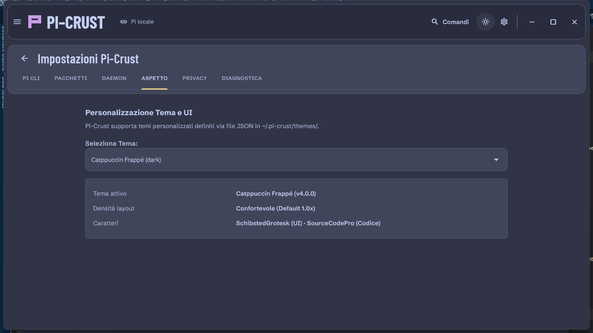

<p align="center">
  <picture>
    <source media="(prefers-color-scheme: dark)" srcset="docs/design-evidence/icons/pi-crust-dark-1024.png">
    <source media="(prefers-color-scheme: light)" srcset="docs/design-evidence/icons/pi-crust-light-1024.png">
    
  </picture>
</p>

<h1 align="center">Pi-Crust</h1>

<p align="center">
  <strong>The modern, resilient Bento GUI for <a href="https://github.com/earendil-works/pi">pi-coding-agent</a>.</strong><br>
  Engineered for developers who demand fluid motion, native desktop speed, and zero lost agent work.
</p>

<p align="center">
  <a href="https://github.com/TrentiStefano/pi-crust/releases/latest"></a>
  
  
  
  <a href="docs/security.md"></a>
  <a href="LICENSE"></a>
</p>

---

## 🎬 A Real Run

Run agents, stream token responses, search and edit repository code with syntax highlighting, steer tasks in-flight, and review Git diffs without leaving the window:

<p align="center">
  <a href="docs/design-evidence/hero.mp4">
    
  </a>
</p>

<p align="center">
  <sub>A real run: the agent streams reasoning and tokens, tool executes tests, code editor highlights syntax with in-file Ctrl+F match cycling, user modifies the steer queue in-flight, stages Git changes, and toggles themes. (<a href="docs/design-evidence/hero.mp4">Watch in full quality MP4</a> · <a href="docs/design-evidence/hero.webp">High-definition WebP</a> · <a href="docs/design-evidence/showcase.html">Interactive Web Demo</a>)</sub>
</p>

---

## 🌟 Why Pi-Crust?

Most AI coding assistants lock you into a monolithic web app or terminal session where closing the tab kills the task. **Pi-Crust** is designed with a **three-tier decoupled architecture**:

1. **🛡 Never Lose Agent Work (Disconnect-Safe):** Close the window, restart your desktop shell, or reload anytime. A background local daemon (`pi-agentd`) keeps the agent running, journals every stream event monotonically, and catches up seamlessly upon GUI reconnect with zero gaps or duplicate events.
2. **📂 100% Native Pi Compatibility:** Authoritative session history remains strictly owned by Pi (`~/.pi/agent/sessions/`). Switch freely between the `pi` terminal CLI and the Pi-Crust GUI at any moment.
3. **🍱 Bento Triptych Workspace:** Co-visible repository code editor, streaming chat transcript, and interactive Git Changes in a balanced three-compartment view inspired by modern editor ergonomics.
4. **🔒 Local-First & Zero Telemetry (Decision D16):** Strictly bound to `127.0.0.1` with cryptographically random tokens. No third-party analytics, no tracking pixels, no outbound calls beyond your configured model provider.

---

## ✨ Features

### 🍱 Bento Triptych Workspace
- **Three co-visible work areas:** Repository file tree & code viewer (Left), Pi chat session (Center), and Git Changes inspector (Right).
- **Responsive adaptation:** Seamlessly adjusts from ultra-wide 1440px+ displays down to compact laptop screens and single-column mobile views.
- **Panel toggles:** Collapse or expand any side panel with a single click or keyboard shortcut.

### ⚡ Interactive Code Viewer & In-File Search
- **Syntax Highlighting:** Automatic programming language detection across Dart, TypeScript, JavaScript, Python, Rust, HTML, CSS, JSON, and Markdown.
- **In-File Search (`Ctrl+F` / `Cmd+F`):** Live text matching with occurrence counter (`1 di N`), previous/next cycling, case-sensitivity toggle, and prominent match highlighting.
- **Instant Save & Edit:** Edit source files directly in the active session's workspace without opening a separate IDE.

### 🎯 Editable Steer Message Queue
- **Direct in-queue editing:** When an agent is streaming an answer, view queued directives in the Composer queue bar.
- **Modify on the fly:** Click **✏️ Modifica** to reword instructions before they reach the agent, or load them back into the composer input field.
- **Queue re-ordering & dismissal:** Remove individual steer or follow-up items with immediate daemon synchronization.

### 🧠 Collapsible Reasoning Streams
- **Deep Thinking inspection:** Collapsible reasoning blocks showing real-time token generation, step duration (e.g. `14.2s`), and tool invocations.
- **Smooth spring animations:** Expand or collapse thoughts without losing your scroll position in long transcripts.

### 🔔 Native OS Notifications
- **Background awareness:** Receive native OS notifications (Windows, macOS, Linux) when the agent completes an answer or requests confirmation, even when Pi-Crust is minimized or out of focus.

### 🌿 Git Changes & Staging Desk
- **Live repository tracking:** Real-time branch indicator, clean/dirty indicator, and line addition/deletion counts (`+42 -6`).
- **File status badges:** Clear visual differentiation between modified (`M`), added (`A`), deleted (`D`), and untracked (`?`) files.
- **Visual Diff Inspector:** Side-by-side or unified inline diff viewer with one-click per-file staging and revert.

### 🎨 Catppuccin Theme Engine
- **Official Catppuccin Palettes:** Ships with **Frappé** (dark) and **Latte** (light) palettes.
- **Hot-Reloadable JSON Themes:** Create custom themes in `~/.pi-crust/themes/` with inheritance (`extends`), contrast verification, and zero hardcoded widget colors.

---

## 📸 Screenshots

| Catppuccin Frappé (Dark) | Catppuccin Latte (Light) |
| :---: | :---: |
| [](docs/design-evidence/bento-triptych-fixture-dark-wide.png) | [](docs/design-evidence/bento-triptych-fixture-wide.png) |
| *Bento Triptych workspace in dark mode* | *Bento Triptych workspace in light mode* |

| Model & Extension Settings | Compact / Single-Pane Mode |
| :---: | :---: |
| [](docs/design-evidence/pi-crust-live-settings-frappe.png) | [](docs/design-evidence/bento-triptych-fixture-compact-file.png) |
| *Model selection, thinking effort, and Pi extensions* | *Compact responsive layout for smaller screens* |

---

## 📥 Download & Installation

Download pre-built binaries from the [**GitHub Releases**](https://github.com/TrentiStefano/pi-crust/releases/latest) page:

| Operating System | Architecture | Installer / Package | Notes |
| :--- | :--- | :--- | :--- |
| **Windows** | `x64` | [`Pi-Crust-Setup-…-windows-x64.exe`](https://github.com/TrentiStefano/pi-crust/releases/latest) | Bundles Node.js & `pi-agentd` |
| **macOS** | `arm64` (Apple Silicon) | [`Pi-Crust-…-macos-arm64.dmg`](https://github.com/TrentiStefano/pi-crust/releases/latest) | Drag to `/Applications` |
| **macOS** | `x64` (Intel) | [`Pi-Crust-…-macos-x64.dmg`](https://github.com/TrentiStefano/pi-crust/releases/latest) | Drag to `/Applications` |
| **Linux** | `x64` (Debian / Ubuntu) | [`Pi-Crust-…-linux-amd64.deb`](https://github.com/TrentiStefano/pi-crust/releases/latest) | `sudo apt install ./Pi-Crust-…deb` |

> [!NOTE]
> Installers bundle the GUI app and the runtime daemon (`pi-agentd`) with an embedded Node.js environment.  
> You only need to ensure the official `pi` CLI is installed on your system.

### Prerequisites

1. **Install Pi CLI** (if not already installed):
   ```bash
   npm install -g @earendil-works/pi-coding-agent
   ```
2. Verify `pi` is accessible from your terminal:
   ```bash
   pi --version
   ```

---

## 🛠 Building from Source

### 1. Clone & Install Dependencies
```bash
# Clone the repository
git clone https://github.com/TrentiStefano/pi-crust.git
cd pi-crust

# Install monorepo dependencies
pnpm install

# Build protocol packages and daemon bundle
pnpm build:all
```

### 2. Start the Daemon (`pi-agentd`)
```bash
# Production mode (connects to your real 'pi' CLI)
pnpm run:daemon

# Or local development mode (no LLM API key needed, uses fake-pi)
# On Windows PowerShell:
$env:PI_CRUST_PI_PATH = "$PWD/tools/fake-pi/dist/index.js"; pnpm run:daemon

# On macOS / Linux:
PI_CRUST_PI_PATH="$PWD/tools/fake-pi/dist/index.js" pnpm run:daemon
```

### 3. Run the Flutter App
```bash
cd apps/pi_crust

# Run natively on your desktop platform:
flutter run -d windows   # or 'macos' / 'linux'

# Or build for web (served via daemon origin):
flutter build web --no-web-resources-cdn
```

---

## 🏗 Architecture & Decoupling

```text
┌───────────────────────────────────────────────────────────────┐
│  Pi-Crust (Flutter Desktop & Web)                             │
│  Windows · macOS · Linux · Web (Chrome / Edge)                │
│  ── Presentation + Session Projection + Command Dispatcher    │
└──────────────────────────┬────────────────────────────────────┘
                           │  PCP/1 (Pi-Crust Protocol, JSON over WebSocket)
                           │  127.0.0.1 · Bearer token · Strict Origin check
                           ▼
┌───────────────────────────────────────────────────────────────┐
│  pi-agentd (TypeScript / Node.js persistent daemon)          │
│                                                               │
│  ConnectionManager   SessionRegistry    EventJournal (Replay) │
│  CommandDispatcher   WorkspaceService   UiRequestBroker       │
│  PiDiscovery         WorkerSupervisor   SnapshotBuilder       │
│                          │                                    │
│                          ▼  PiTransport (interface)           │
│                     StdioPiTransport                          │
└──────────────────────────┬────────────────────────────────────┘
                           │  JSONL strict LF over stdin/stdout
              ┌────────────┼────────────┬────────────┐
              ▼            ▼            ▼            ▼
        pi --mode rpc  pi --mode rpc  pi --mode rpc  …
         (Session A)    (Session B)    (Session C)
              │
              ▼
        ~/.pi/agent/sessions/--<path>--/<ts>_<uuid>.jsonl
        (Source of truth of history — owned exclusively by Pi)
```

| Layer | Responsibility | Isolation Guarantee |
| :--- | :--- | :--- |
| **Pi-Crust (Flutter)** | UI presentation, Bento triptych layout, state reduction, animations, and theme engine. | Knows **nothing** about child processes, stdio streams, or raw session files. |
| **pi-agentd (Daemon)** | Process supervisor, monotonic event journal, session reconnect replay, Git diff client, and RPC bridge. | Knows **nothing** about Flutter widgets or layout logic. |
| **Pi (`pi-coding-agent`)** | LLM orchestrator, model execution, tool invocation, and file system modifications. | Unaware that Pi-Crust exists; operates as a standard headless RPC worker. |

---

## 🧪 Testing & Verification

Pi-Crust enforces 100% test passing across Dart, TypeScript, and protocol specifications:

```bash
# Run all unit, contract, security, and Flutter tests
pnpm test

# Run Flutter tests directly
cd apps/pi_crust
flutter test

# Run End-to-End fault injection test suites
pnpm test:e2e

# Smoke test with real Pi CLI over loopback mock model
pnpm smoke:real-pi
```

---

## 📂 Repository Layout

```text
pi-crust/
├── apps/
│   ├── pi_crust/                 # Flutter application (Windows, macOS, Linux, Web)
│   │   ├── lib/                  # App shell, Bento workspace, syntax highlighter, composer
│   │   ├── assets/themes/        # Bundled Catppuccin themes (crust-dark, crust-light)
│   │   └── test/                 # 87+ widget, stress, layout, and lint tests
│   └── agentd/                   # Persistent Node.js/TypeScript daemon
│       ├── src/server/           # HTTP/WebSocket server, token auth, static SPA host
│       ├── src/sessions/         # Session registry, supervisor, indexer
│       ├── src/journal/          # Monotonic event journal, buffer, snapshot generator
│       ├── src/workspace/        # WorkspaceService, read-only Git client
│       └── src/ui/               # UiRequestBroker (claim/lease broker)
├── packages/
│   ├── pcp-spec/                 # PCP/1 protocol specification & JSON Schemas
│   ├── pcp-ts/                   # Generated TypeScript types & validators
│   ├── pi_crust_protocol/        # Generated Dart types & codec for Flutter
│   └── pi_crust_theme/           # Dart theme engine with JSON inheritance & hot-reload
├── docs/                         # Architecture, Security baseline, ADRs, Installation guides
│   └── design-evidence/         # High-res UI fixtures, showcase videos, and icon assets
├── tools/                        # fake-pi mock server, fault-proxy, codegen scripts
└── test/e2e/                     # Cross-component end-to-end integration tests
```

---

## 📄 License

This project is open-source and available under the [MIT License](LICENSE).