<p align="center">
  <picture>
    <source media="(prefers-color-scheme: dark)" srcset="docs/design-evidence/icons/piframe-dark-1024.png">
    <source media="(prefers-color-scheme: light)" srcset="docs/design-evidence/icons/piframe-light-1024.png">
    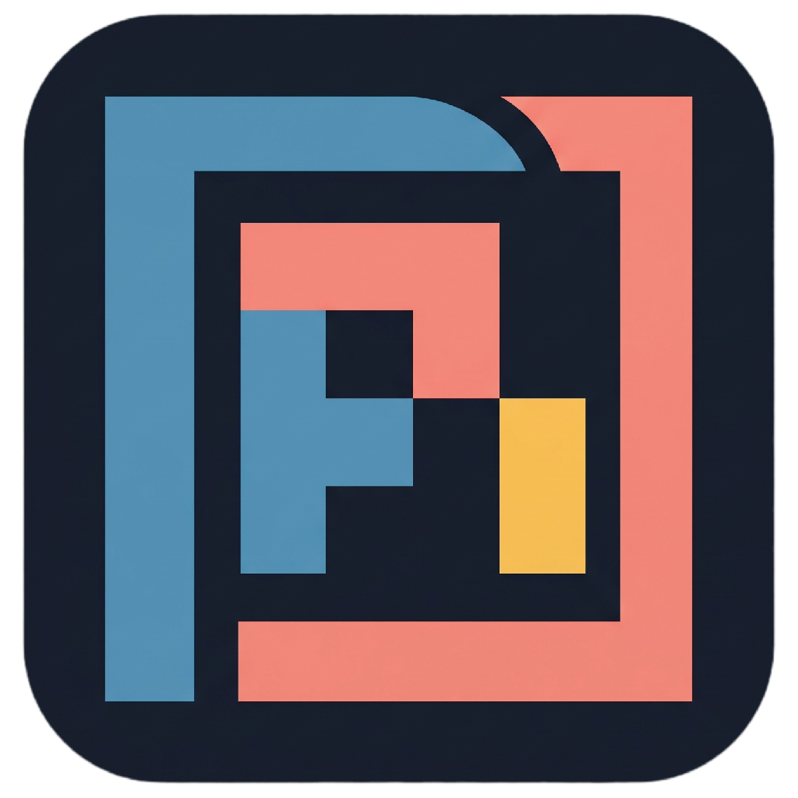
  </picture>
</p>

<h1 align="center">PiFrame</h1>

<p align="center">
  <strong>The modern, resilient Bento GUI for <a href="https://github.com/earendil-works/pi">pi-coding-agent</a>.</strong><br>
  Engineered for developers who demand fluid 120fps motion, native desktop speed, and zero lost agent work.
</p>

<p align="center">
  <a href="https://github.com/TrentiStefano/piframe/releases/latest"></a>
  
  
  
  <a href="docs/security.md"></a>
  <a href="LICENSE"></a>
</p>

---

## 🎬 A Real Run

Run agents, stream token responses, search and edit repository code with syntax highlighting, steer tasks in-flight, manage Git changes, and run commands inside the integrated terminal without leaving the window:

<p align="center">
  <a href="docs/design-evidence/bento-triptych-fixture-dark-wide.png">
    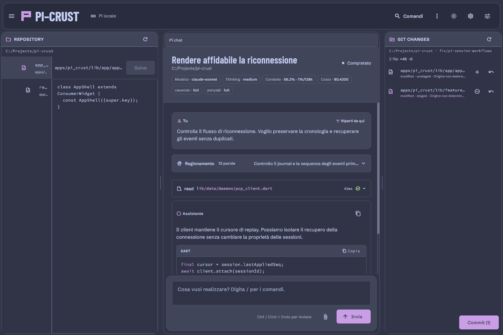
  </a>
</p>

<p align="center">
  <sub>A real run: the agent streams reasoning and tokens, tool executes tests, code editor highlights syntax with in-file Ctrl+F match cycling, user modifies the steer queue in-flight, stages Git changes, uses the embedded terminal, and toggles themes. (<a href="docs/design-evidence/showcase.html">Interactive Web Demo</a> · <a href="docs/design-evidence/bento-triptych-fixture-dark-wide.png">View Full Resolution Capture</a>)</sub>
</p>

---

## 🌟 Why PiFrame?

Most AI coding assistants lock you into a monolithic web app or terminal session where closing the tab kills the task. **PiFrame** is built on a **three-tier decoupled architecture**:

1. **🛡 Never Lose Agent Work (Disconnect-Safe):** Close the window, restart your desktop shell, or reload anytime. A background local daemon (`pi-agentd`) keeps the agent running, journals every stream event monotonically, and catches up seamlessly upon GUI reconnect with zero gaps or duplicate events.
2. **📂 100% Native Pi Compatibility:** Authoritative session history remains strictly owned by Pi (`~/.pi/agent/sessions/`). Switch freely between the `pi` terminal CLI and the PiFrame GUI at any moment.
3. **🍱 Bento Triptych Workspace:** Co-visible repository code editor, streaming chat transcript, and interactive Git Changes / Web Browser in a balanced three-compartment view inspired by modern editor ergonomics.
4. **🔒 Local-First & Zero Telemetry (Decision D16):** Strictly bound to `127.0.0.1` with cryptographically random tokens. No third-party analytics, no tracking pixels, no outbound calls beyond your configured model provider.

---

## ✨ Features & Functionality

### 🍱 Bento Triptych Workspace & Companion Panes
- **Three co-visible work areas:** Repository file tree & code viewer (Left), Pi chat session (Center), and Git Changes inspector / Live Web Browser (Right).
- **Responsive adaptation:** Seamlessly adjusts from ultra-wide 1440px+ displays down to compact laptop screens and single-column mobile views.
- **Collapsible Panes:** Easily collapse or expand side panels with instant keyboard shortcuts or one-click headers.
- **Unified Companion Tabs:** Seamlessly toggle between File Explorer, Code Editor, Git Review Changes, Embedded Browser, and the Integrated Terminal with exclusive active-pane controls.

### 🌐 Embedded Chromium Web Browser (Live In-App Browsing)
- **Native WebView2 Engine:** Full Chromium-powered web browser embedded directly inside the right companion pane on desktop.
- **Multi-Engine Search:** Quick search bar integrated with Google, DuckDuckGo, YouTube, pub.dev, GitHub, Wikipedia, Stack Overflow, and MDN Web Docs.
- **Tab & History Management:** Multi-tab browsing with back/forward history, reload, home, and custom bookmark shortcuts.
- **Chat Copilot Integration:** Send web pages, documentation snippets, and reference URLs straight to the agent composer with one click.

### 💻 Integrated Terminal with Native OS Integration & WSL
- **Direct Hardware Typing:** High-performance integrated terminal emulator embedded directly inside your workspace with hardware-level keyboard typing.
- **Native OS Shells:** Spawns native PowerShell / cmd on Windows, zsh / bash on macOS and Linux.
- **First-Class WSL Support:** Open repositories located inside the Windows Subsystem for Linux (WSL) and run commands directly through an integrated WSL bash terminal.

### 📋 Live Agent ToDo Breakdown & Interactive Tasks
- **Real-Time Task Checklists:** Interactive agent task list panel rendering progress in real time as the agent plans and executes multi-step work.
- **Synchronized Checkboxes:** Watch tasks auto-check as milestones are completed, with direct status toggling and chat transition notifications.
- **Runaway & Duplicate Prevention:** Robust parser safeguards prevent duplicate task generation or counter runaway during high-speed token streaming.

### 🤖 Popdown Subagents Panel & Dedicated Monitoring
- **Dedicated Subagent Drawer:** Monitor parallel or nested subagents spawned during complex tasks with dedicated booktab indicators.
- **Live Output & Steering:** Expand individual subagent execution streams, supply directional steer input, and stop unresponsive subagents individually.
- **Subsession Cost Tracking:** Real-time cost reconciliation and cumulative token accounting across all child workers.

### 🎯 In-Flight Visual Steer Queue
- **Non-Interruptive Steering:** Queue, modify, or dismiss pending steer directions while responses stream without interrupting generation.
- **Re-Order & In-Flight Editing:** Drag or edit steer instructions before the agent begins their execution.
- **Double-Send Safeguards:** Robust state synchronization prevents duplicate steers on agent interrupt, model switch, or resend actions.

### 🔍 Git Changes Review Desk & 50/50 Split Diff
- **50/50 Split Review Pane:** Dedicated side-by-side or unified diff viewing to inspect changes before committing.
- **Comprehensive File Tracking:** Real-time visibility into modified (`M`), added (`A`), deleted (`D`), and untracked (`?`) files.
- **Markdown Live Preview:** Toggle live rendered markdown previews for `.md` files right within the workspace editor.
- **Staging & Revert Controls:** Stage, unstage, or discard changes with one click.

### 🔌 MCP Server Management (Model Context Protocol)
- **Interactive Server Cards:** Click the Model Context Protocol (MCP) badge to view all configured and active MCP tools and servers.
- **Dynamic Server Toggles:** Enable or disable specific MCP servers with intuitive checkboxes without restarting sessions.

### ⏱ Real-Time Context Usage & Multi-Model Cost Analytics
- **Live Cost & Token Metering:** Accurate real-time session cost and token accumulation tracking mirroring CLI/TUI metrics.
- **Multi-Model Cost Breakdown:** Detailed cost inspection dialog breaking down expenditures per model across turns and sub-sessions.
- **Context Window Selector:** Explicitly pick model context bounds for variable-context models (e.g., Luna, Haiku) to optimize performance and billing.

### ✍️ Expanded Composer, File Mentions & Drag-and-Drop
- **Large Prompt Composer:** Toggle an enlarged input window with rich multiline textarea when composing lengthy prompts.
- **Animated Minimization:** Smooth spring transition automatically minimizes composer input with pointer glow while the agent generates, expanding after 5 seconds or upon click.
- **`@` File Mentions & `/` Slash Menus:** Quick-search repository files and slash commands directly in the input box.
- **Drag & Drop Attachments:** Drag and drop images or text files directly into chat; view files with inline transcript chips and full-screen lightbox preview.
- **Direct Workspace Navigation:** `Ctrl+Click` on file mentions in the transcript to open the file directly in the OS file explorer or internal editor.
- **Inline Session Rename:** Double-click or press Enter on the session header to rename sessions on the fly.

### 📝 AI Instruction File Generator (`AGENTS.md` / `PI.md`)
- **Direct Instruction Editor:** View, edit, and maintain repository-specific instruction files (`AGENTS.md`, `PI.md`) from the session header or sidebar.
- **AI-Assisted Generation:** Generate tailored project instructions using the Pi agent directly from a guided dialog.

### 🚀 Quick Launch Welcome Screen & Startup Assembly Animation
- **Landing Quick Launch:** Welcome page displaying the latest 5 active sessions with instant resume, project paths, and quick folder selection.
- **Startup Logo Assembly:** Smooth geometric logo assembly animation on launch with subtle framing audio.
- **Window Geometry Persistence:** Automatically saves and restores desktop window position, size, and maximized state across app restarts.

### 🎨 Custom Theme Customizer & VSCode JSON Import
- **Official Normative Palettes:** Preloaded with precision-tuned **PiFrame Dark** (`#161c27`) and **PiFrame Light** (`#f1f3f7`) themes with automatic system theme tracking.
- **Interactive Theme Editor:** Customize base colors, surface tones, chassis borders, and accent highlights with live component preview cards.
- **VSCode Theme Import:** Import standard VSCode JSON theme files directly into PiFrame.
- **Custom JSON Themes:** Add hot-reloadable themes in `~/.piframe/themes/` with full token inheritance.
- **Multi-Language Support:** Language dropdown in Appearance settings for localized user experience.

### 🌐 Secure Remote Web Access (Tailscale & Cloudflare)
- **Zero-Config Remote Web Access:** Securely access and control your desktop agent sessions from mobile browsers (iPhone, iPad, Android) or secondary laptops.
- **Tunnels Supported:** Built-in integration for Tailscale and Cloudflare tunnels.
- **Secure Pairing:** Connect with a 6-digit PIN or QR code with automatic credential expiration.
- **View vs. Control Modes:** Fine-grained authorization controls to enforce read-only viewing or explicit authorization for terminal and file modifications.
- **Mobile-Tailored UI:** Specially tuned responsive layout and touch-friendly controls for mobile browsers.

### 🔔 Native OS Notifications & Auto-Update Engine
- **Background Completion Alerts:** Receive native OS notifications and desktop snackbars when the agent finishes long runs or requests human input while unfocused.
- **Startup Update Checker:** Real-time startup notification banner alerting when Pi CLI or PiFrame updates are available.
- **One-Click Updates:** Launch background updates with release highlights directly from Settings.
- **First-Run Onboarding:** Prompts to install `pi-coding-agent` on first launch if not detected on your system.

---

## 📸 Screenshots & Visual Tour

### Bento Workspace & Themes
| PiFrame Dark (Default) | PiFrame Light |
| :---: | :---: |
| [](docs/design-evidence/bento-triptych-fixture-dark-wide.png) | [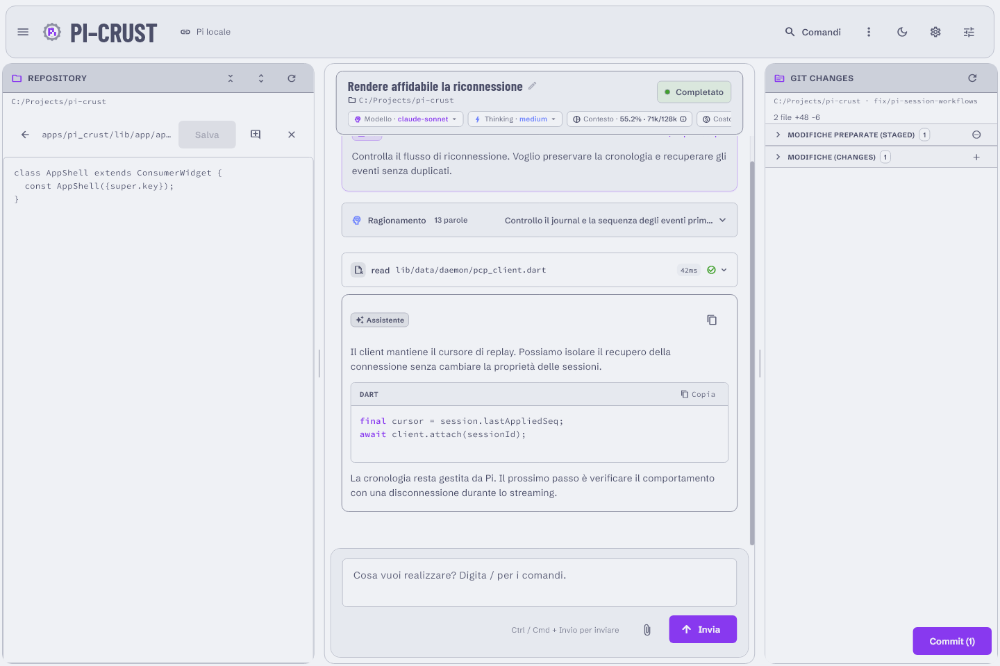](docs/design-evidence/bento-triptych-fixture-wide.png) |
| *Bento Triptych workspace running official PiFrame Dark theme (`#161c27`)* | *Bento Triptych workspace running official PiFrame Light theme (`#f1f3f7`)* |

### Autonomous Workflow & In-Flight Steering
| In-Flight Steer Queue | Real-Time Reasoning & Thinking Stream |
| :---: | :---: |
| [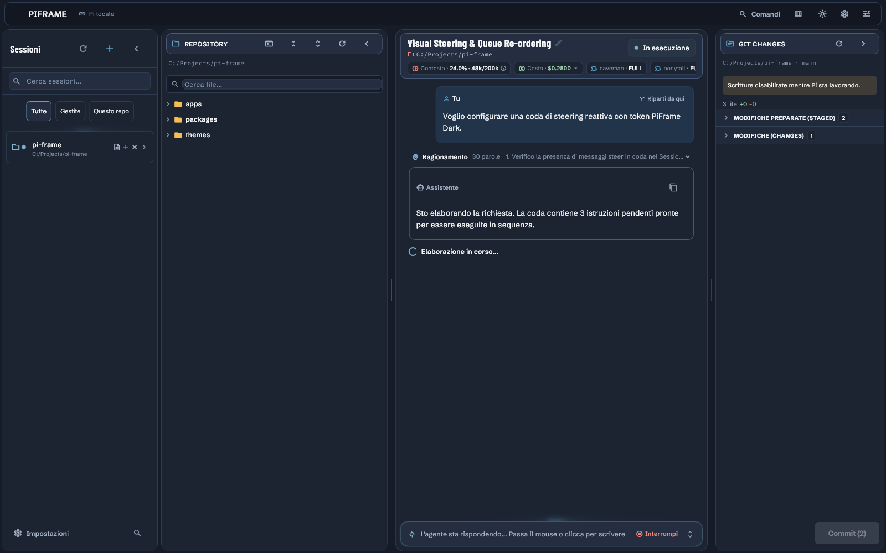](docs/design-evidence/recordly-projects/clip-04-steer-queue.preview.png) | [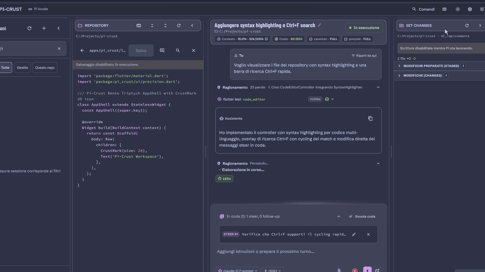](docs/design-evidence/recordly-projects/clip-06-reasoning-stream.preview.png) |
| *Modify, prioritize, and steer agent reasoning without interrupting token generation* | *High-framerate token stream with granular thinking inspection, live cost, and tool timing* |

### Code Navigation & Git Staging Desk
| Git Changes Review Desk (50/50 Diff) | Syntax Highlighting & Code Search (Ctrl+F) |
| :---: | :---: |
| [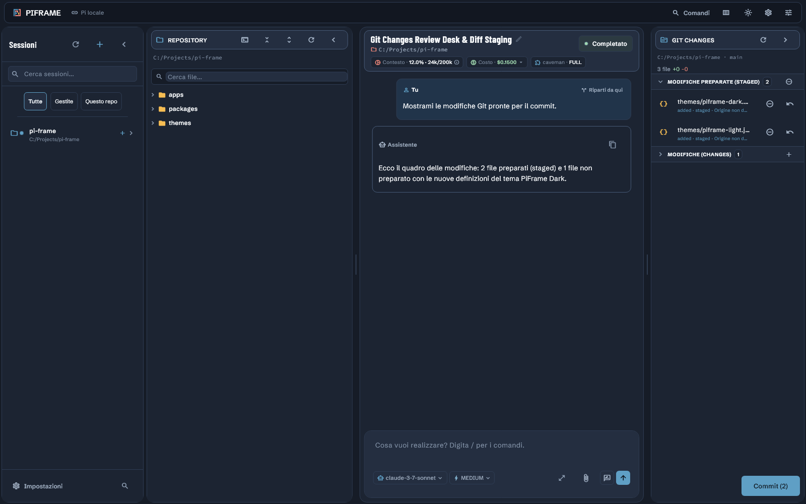](docs/design-evidence/recordly-projects/clip-08-git-staging.preview.png) | [](docs/design-evidence/recordly-projects/clip-03-code-search.preview.png) |
| *50/50 split diff inspection, one-click staging, and file discard actions* | *Syntax-highlighted repository code viewer with in-file match cycling and line numbers* |

### Session Navigation & Command Palette
| Grouped Repository Session Tree | Command Palette (Ctrl+P / Cmd+P) |
| :---: | :---: |
| [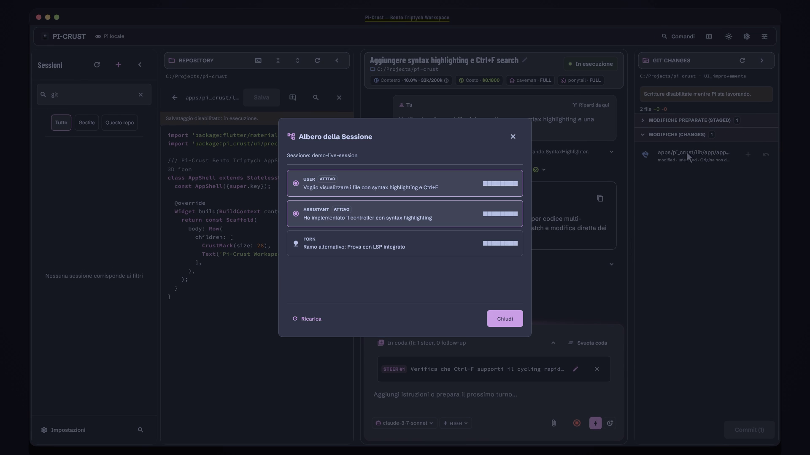](docs/design-evidence/recordly-projects/clip-09-session-tree.preview.png) | [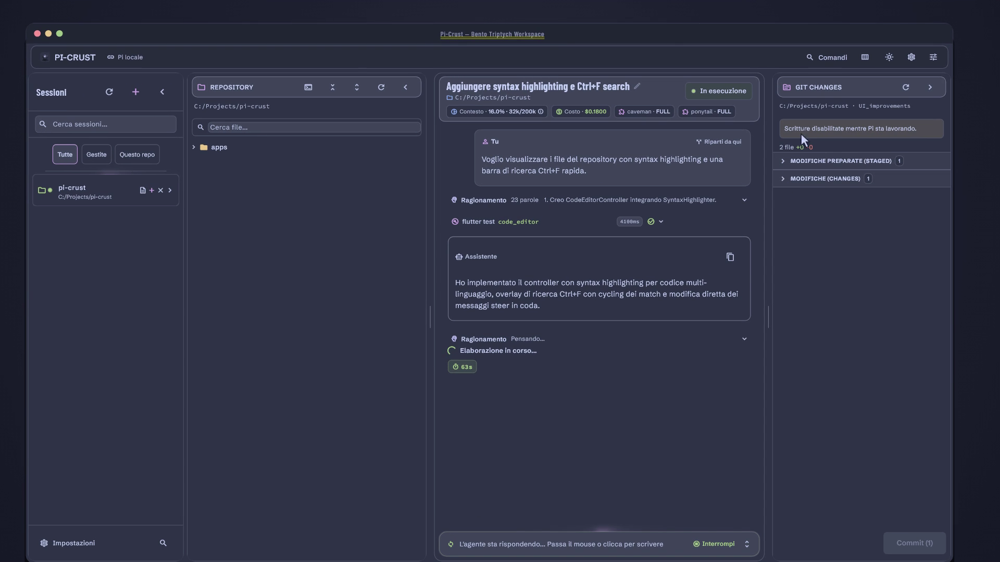](docs/design-evidence/recordly-projects/clip-02-command-palette.preview.png) |
| *Session tree grouped by repository with search, pinned sessions, and status pills* | *Fast keyboard-driven command palette for workspace navigation and panel actions* |

### Quick Launch & AI Instruction Generator
| Landing Page Quick Launch | AI Instruction File Generator |
| :---: | :---: |
| [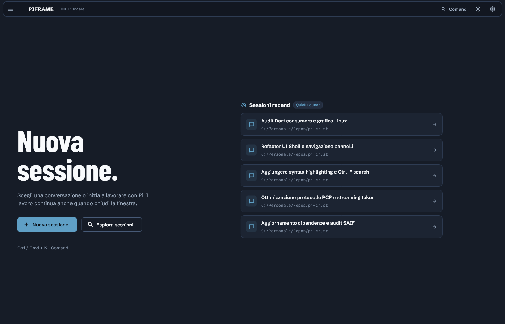](docs/design-evidence/recordly-projects/01_landing_quick_launch.png) | [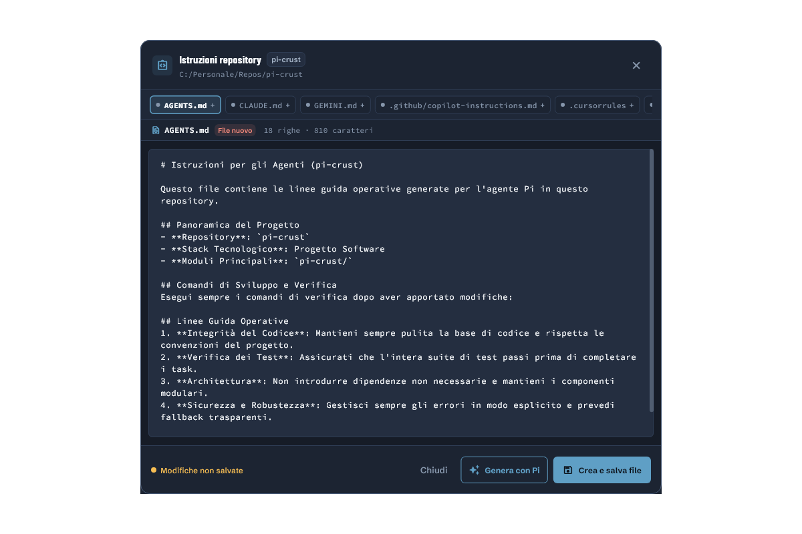](docs/design-evidence/recordly-projects/02_instruction_dialog.png) |
| *Welcome screen with recent 5 active sessions for instant one-click resume* | *Generate and refine repository-specific `AGENTS.md` and `PI.md` instruction files* |

### Customization & Responsive Layouts
| Theme Editor & Live Preview | Appearance Settings & Language |
| :---: | :---: |
| [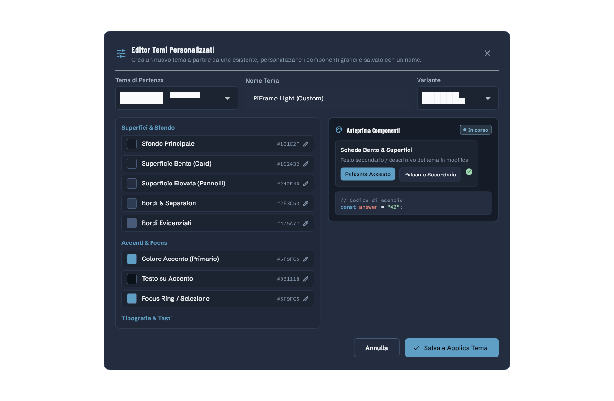](docs/design-evidence/recordly-projects/04_theme_editor.png) | [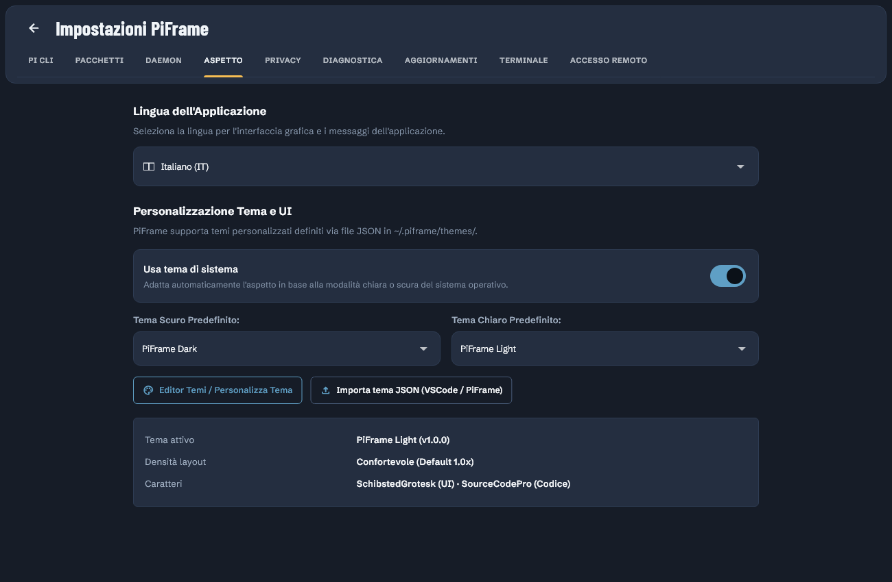](docs/design-evidence/recordly-projects/05_appearance_settings.png) |
| *Dedicated Theme Customizer with live component preview cards and token inheritance* | *Appearance settings with custom theme selection and application language dropdown* |

| Context & Cost Analytics | Compact Responsive Layout |
| :---: | :---: |
| [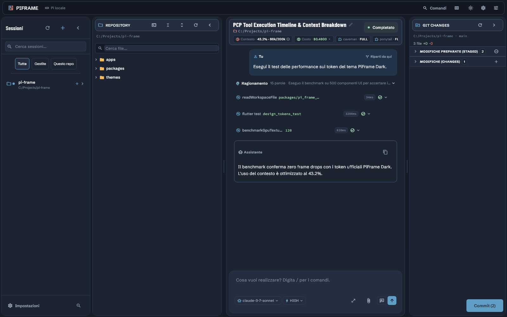](docs/design-evidence/recordly-projects/clip-05-context-analytics.preview.png) | [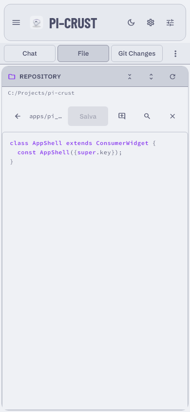](docs/design-evidence/bento-triptych-fixture-compact-file.png) |
| *Real-time context window usage, cumulative cost, and token accumulation tracking* | *Seamless responsive adaptation for smaller laptops and single-pane viewports* |

---

## 📥 Download & Installation

Download pre-built binaries from the [**GitHub Releases**](https://github.com/TrentiStefano/piframe/releases/latest) page:

| Operating System | Architecture | Installer / Package | Notes |
| :--- | :--- | :--- | :--- |
| **Windows** | `x64` | [`PiFrame-Setup-…-windows-x64.exe`](https://github.com/TrentiStefano/piframe/releases/latest) | Bundles Node.js & `pi-agentd` |
| **macOS** | `arm64` (Apple Silicon) | [`PiFrame-…-macos-arm64.dmg`](https://github.com/TrentiStefano/piframe/releases/latest) | Drag to `/Applications` |
| **macOS** | `x64` (Intel) | [`PiFrame-…-macos-x64.dmg`](https://github.com/TrentiStefano/piframe/releases/latest) | Drag to `/Applications` |
| **Linux** | `x64` (Debian / Ubuntu) | [`PiFrame-…-linux-amd64.deb`](https://github.com/TrentiStefano/piframe/releases/latest) | `sudo apt install ./PiFrame-…deb` |

> [!NOTE]
> Installers bundle the GUI app and the runtime daemon (`pi-agentd`) with an embedded Node.js environment.  
> You only need to ensure the official `pi` CLI is installed on your system.

### Prerequisites

1. **Install Pi CLI** (if not already installed):
   ```bash
   npm install -g @earendil-works/pi-coding-agent
   ```
2. Verify `pi` is accessible from your terminal:
   ```bash
   pi --version
   ```

---

## 🛠 Building from Source

### 1. Clone & Install Dependencies
```bash
# Clone the repository
git clone https://github.com/TrentiStefano/piframe.git
cd piframe

# Install monorepo dependencies
pnpm install

# Build protocol packages and daemon bundle
pnpm build:all
```

### 2. Start the Daemon (`pi-agentd`)
```bash
# Production mode (connects to your real 'pi' CLI)
pnpm run:daemon

# Or local development mode (no LLM API key needed, uses fake-pi)
# On Windows PowerShell:
$env:PI_FRAME_PI_PATH = "$PWD/tools/fake-pi/dist/index.js"; pnpm run:daemon

# On macOS / Linux:
PI_FRAME_PI_PATH="$PWD/tools/fake-pi/dist/index.js" pnpm run:daemon
```

### 3. Run the Flutter App
```bash
cd apps/pi_frame

# Run natively on your desktop platform:
flutter run -d windows   # or 'macos' / 'linux'

# Or build for web (served via daemon origin):
flutter build web --no-web-resources-cdn
```

---

## 🏗 Architecture & Decoupling

```text
┌───────────────────────────────────────────────────────────────┐
│  PiFrame (Flutter Desktop & Web)                              │
│  Windows · macOS · Linux · Web (Chrome / Edge)                │
│  ── Presentation + Session Projection + Command Dispatcher    │
└──────────────────────────┬────────────────────────────────────┘
                           │  PCP/1 (PiFrame Protocol, JSON over WebSocket)
                           │  127.0.0.1 · Bearer token · Strict Origin check
                           ▼
┌───────────────────────────────────────────────────────────────┐
│  pi-agentd (TypeScript / Node.js persistent daemon)          │
│                                                               │
│  ConnectionManager   SessionRegistry    EventJournal (Replay) │
│  CommandDispatcher   WorkspaceService   UiRequestBroker       │
│  PiDiscovery         WorkerSupervisor   SnapshotBuilder       │
│                          │                                    │
│                          ▼  PiTransport (interface)           │
│                     StdioPiTransport                          │
└──────────────────────────┬────────────────────────────────────┘
                           │  JSONL strict LF over stdin/stdout
              ┌────────────┼────────────┬────────────┐
              ▼            ▼            ▼            ▼
        pi --mode rpc  pi --mode rpc  pi --mode rpc  …
         (Session A)    (Session B)    (Session C)
              │
              ▼
        ~/.pi/agent/sessions/--<path>--/<ts>_<uuid>.jsonl
        (Source of truth of history — owned exclusively by Pi)
```

| Layer | Responsibility | Isolation Guarantee |
| :--- | :--- | :--- |
| **PiFrame (Flutter)** | UI presentation, Bento triptych layout, state reduction, animations, and theme engine. | Knows **nothing** about child processes, stdio streams, or raw session files. |
| **pi-agentd (Daemon)** | Process supervisor, monotonic event journal, session reconnect replay, Git diff client, and RPC bridge. | Knows **nothing** about Flutter widgets or layout logic. |
| **Pi (`pi-coding-agent`)** | LLM orchestrator, model execution, tool invocation, and file system modifications. | Unaware that PiFrame exists; operates as a standard headless RPC worker. |

---

## 🧪 Testing & Verification

PiFrame enforces 100% test passing across Dart, TypeScript, and protocol specifications:

```bash
# Run all unit, contract, security, and Flutter tests
pnpm test

# Run Flutter tests directly
cd apps/pi_frame
flutter test

# Run End-to-End fault injection test suites
pnpm test:e2e

# Smoke test with real Pi CLI over loopback mock model
pnpm smoke:real-pi
```

---

## 🔧 Troubleshooting & Known Issues

Encountering an issue? Check [**docs/troubleshooting.md**](docs/troubleshooting.md) for solutions to common environment problems:
- **Windows Blank / White Window on Startup**: Resolving ANGLE/DirectX surface presentation issues on multi-GPU or virtual display driver setups (`USB Mobile Monitor`, `IddSampleDriver`, Spacedesk).
- **Remote Web & Smartphone Access**: Verifying pairing tokens, Tailscale / Cloudflare tunnel routing, and serving mobile-optimized web assets.

---

## 📂 Repository Layout

```text
piframe/
├── apps/
│   ├── pi_frame/                 # Flutter application (Windows, macOS, Linux, Web)
│   │   ├── lib/                  # App shell, Bento workspace, syntax highlighter, composer, browser
│   │   ├── assets/themes/        # Bundled themes (piframe-dark, piframe-light)
│   │   └── test/                 # 87+ widget, stress, layout, and lint tests
│   └── agentd/                   # Persistent Node.js/TypeScript daemon
│       ├── src/server/           # HTTP/WebSocket server, token auth, static SPA host
│       ├── src/sessions/         # Session registry, supervisor, indexer
│       ├── src/journal/          # Monotonic event journal, buffer, snapshot generator
│       ├── src/workspace/        # WorkspaceService, read-only Git client
│       └── src/ui/               # UiRequestBroker (claim/lease broker)
├── packages/
│   ├── pcp-spec/                 # PCP/1 protocol specification & JSON Schemas
│   ├── pcp-ts/                   # Generated TypeScript types & validators
│   ├── pi_frame_protocol/        # Generated Dart types & codec for Flutter
│   └── pi_frame_theme/           # Dart theme engine with JSON inheritance & hot-reload
├── docs/                         # Architecture, Security baseline, ADRs, Installation guides
│   └── design-evidence/         # High-res UI fixtures, showcase videos, and icon assets
├── tools/                        # fake-pi mock server, fault-proxy, codegen scripts
└── test/e2e/                     # Cross-component end-to-end integration tests
```

---

## 📄 License

This project is open-source and available under the [MIT License](LICENSE).
