<p align="center">
  <picture>
    <source media="(prefers-color-scheme: dark)" srcset="docs/design-evidence/icons/piframe-dark-1024.png">
    <source media="(prefers-color-scheme: light)" srcset="docs/design-evidence/icons/piframe-light-1024.png">
    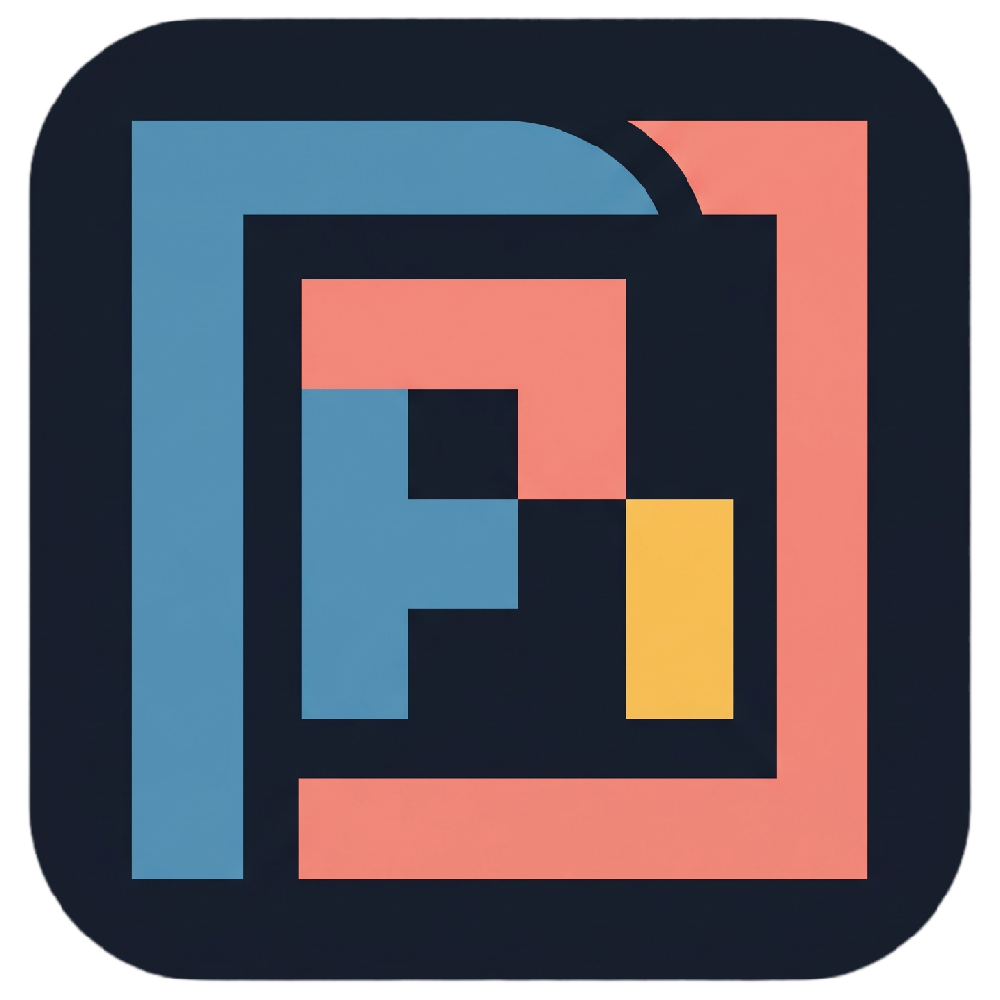
  </picture>
</p>

<h1 align="center">PiFrame</h1>

<p align="center">
  <strong>The desktop GUI for the <a href="https://github.com/earendil-works/pi">Pi Coding Agent</a>.</strong><br>
  Your Pi setup, packages and sessions in a desktop workspace with side-by-side diffs, Git,<br>
  and an agent that keeps working when you close the window.
</p>

<p align="center">
  <a href="https://github.com/TrentiStefano/PiFrame/releases/latest"></a>
  
  <a href="docs/security.md"></a>
  <a href="LICENSE"></a>
</p>

<p align="center">
  <a href="https://trentistefano.github.io/PiFrame/"><strong>Website</strong></a> ·
  <a href="https://github.com/TrentiStefano/PiFrame/releases/latest"><strong>Download</strong></a> ·
  <a href="docs/install.md">Install guide</a> ·
  <a href="docs/troubleshooting.md">Troubleshooting</a>
</p>

<p align="center">
  <a href="https://trentistefano.github.io/PiFrame/">
    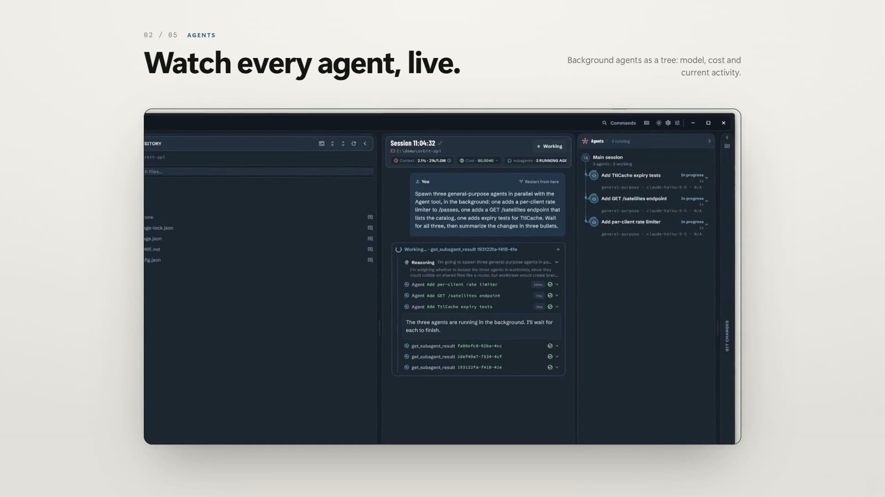
  </a>
  <br>
  <sub>Recorded from the real app. <a href="https://trentistefano.github.io/PiFrame/">Watch the 26-second video on the website</a>.</sub>
</p>

---

## Why PiFrame?

**Drop-in for Pi users. Zero risk to try.**
PiFrame starts your installed `pi` (`pi --mode rpc`) and uses your existing config, providers, models, packages, skills and sessions. Sessions stay in Pi's own folder (`~/.pi/agent/sessions/`), so you can switch between the `pi` CLI and PiFrame at any time. PiFrame keeps its own data in `~/.piframe/` and changes files in `~/.pi/` only when you ask it to from the app (for example deleting a session, toggling an MCP server or editing agent settings). Uninstalling PiFrame leaves Pi and your sessions in place.

**Disconnect-safe.**
Pi runs inside a local background service (`pi-agentd`), not inside the window. Close the window mid-turn and the agent keeps working. Reopen PiFrame and it reconnects and catches up, using a local log of the session's events.

**Local and private.**
The background service listens only on `127.0.0.1` and requires a random per-install token. PiFrame has no analytics and no telemetry. Network traffic is what Pi sends to your model provider, plus the optional update check and the remote access you choose to enable. See [docs/security.md](docs/security.md).

**A real desktop app.**
Installers for Windows, macOS and Linux bundle everything PiFrame needs (Pi itself stays your own install). Repository, chat and Git live in one window, with an integrated terminal for PowerShell, bash, zsh or WSL. The interface is available in English and Italian.

---

## Features

All images are captures of the real app (demo profile and demo repository).

### Close the window, the agent keeps working
[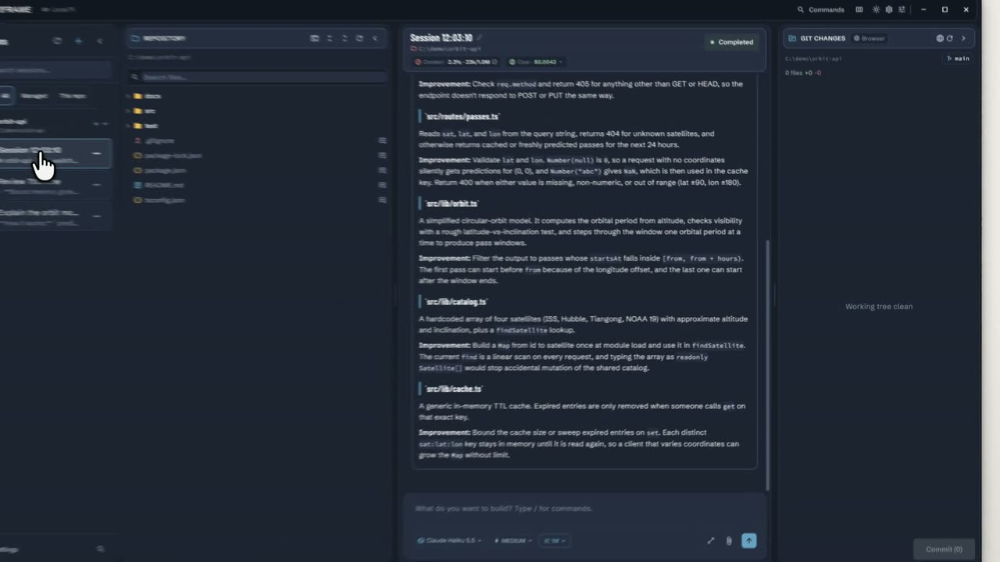](https://trentistefano.github.io/PiFrame/#disconnect-safe)

### Watch every agent, live
Background agents appear as a tree with their model, cost and current activity. Open one to read its output, steer it, or stop it.

[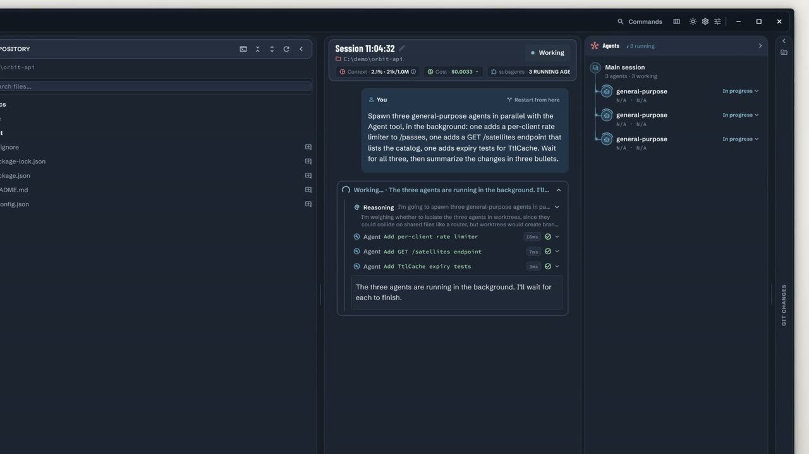](https://trentistefano.github.io/PiFrame/#agents-tree)

### Repository, chat and Git in one window
File tree and code viewer, the Pi chat, and Git changes side by side. Panels collapse when you need space. On Windows, the right panel also has a built-in web browser.

[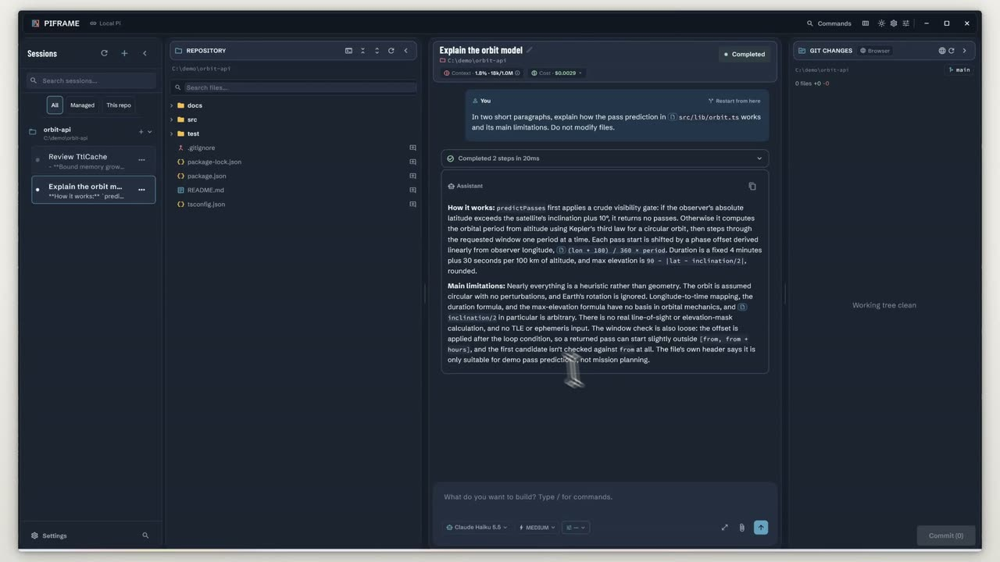](https://trentistefano.github.io/PiFrame/#workspace)

### Review the diff before you commit
Side-by-side or unified diffs with syntax highlighting. Stage, unstage or discard files, write the commit and switch branches from the Git panel.

| Review diff | Git: stage, commit, branch |
| :---: | :---: |
| [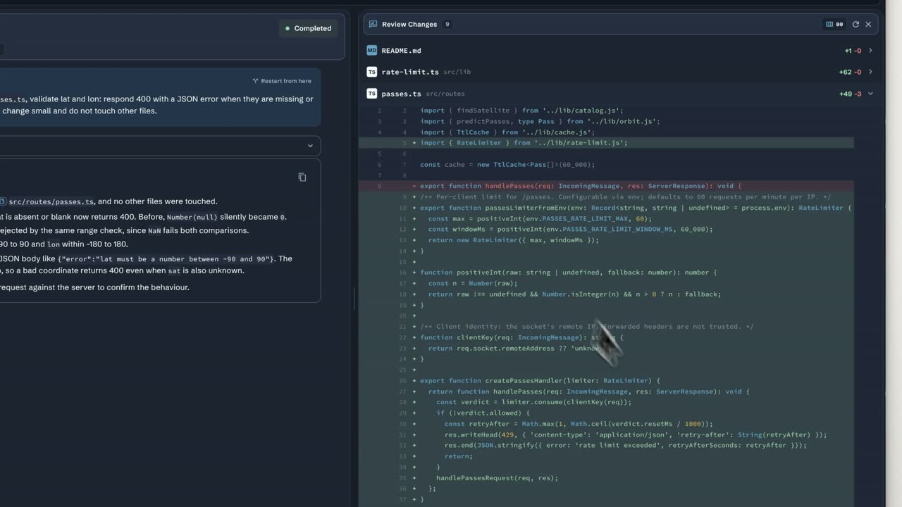](https://trentistefano.github.io/PiFrame/#review-diff) | [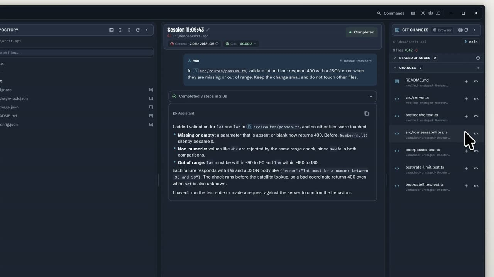](https://trentistefano.github.io/PiFrame/#showcase) |

### And more

| | |
| :---: | :---: |
| [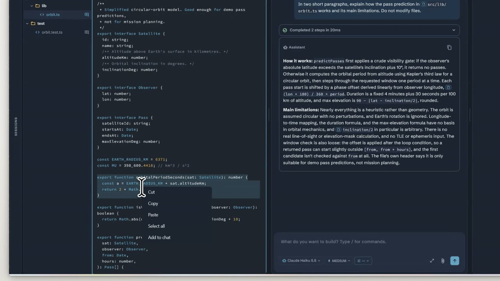](https://trentistefano.github.io/PiFrame/#showcase) | [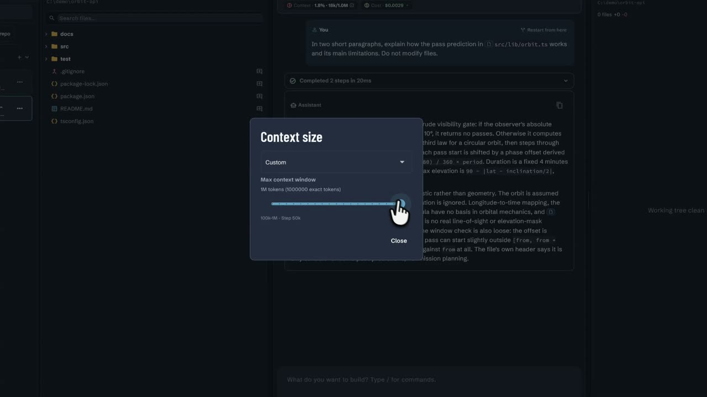](https://trentistefano.github.io/PiFrame/#showcase) |
| **Add files to the chat** from the repository tree, with `@` mentions or by drag and drop. | **Model, thinking level and context window** per session, with live context usage and cost. |
| [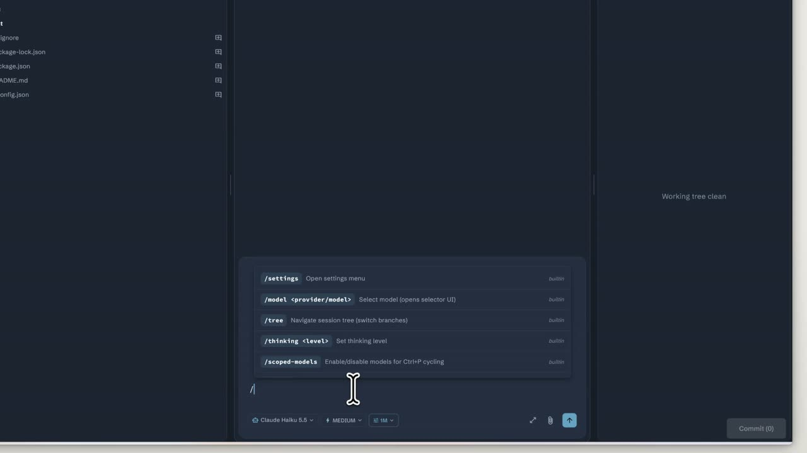](https://trentistefano.github.io/PiFrame/#showcase) | [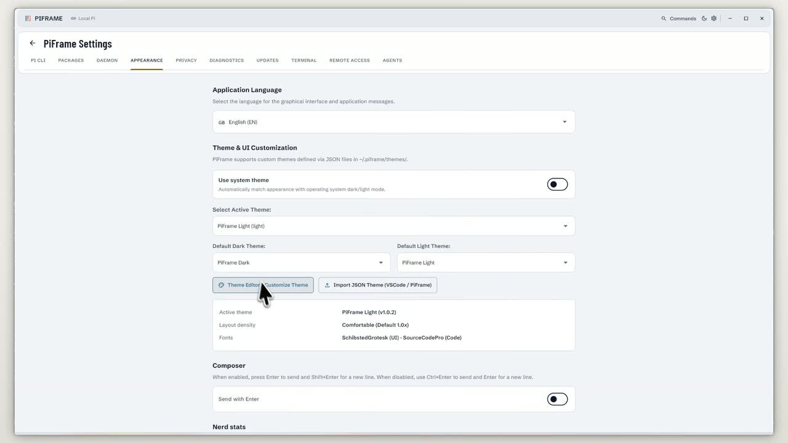](https://trentistefano.github.io/PiFrame/#showcase) |
| **Composer:** `/` commands, attachments, and steering messages you can edit while the agent works. | **Themes:** light, dark, a live theme editor, and VS Code theme import. |

### Remote access from your phone (opt-in)
Follow or control a session from a phone browser over Tailscale (or a temporary Cloudflare Quick Tunnel). Pair a device by scanning a one-time QR code that expires after a few minutes. Each device gets *view* or *control* rights. Remote access is off until you turn it on.

<p align="center">
  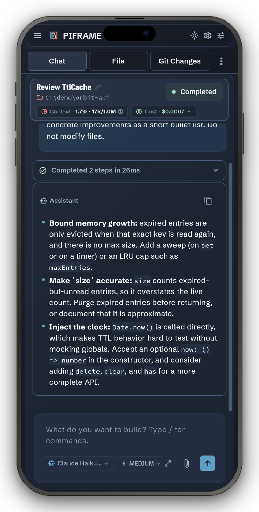
  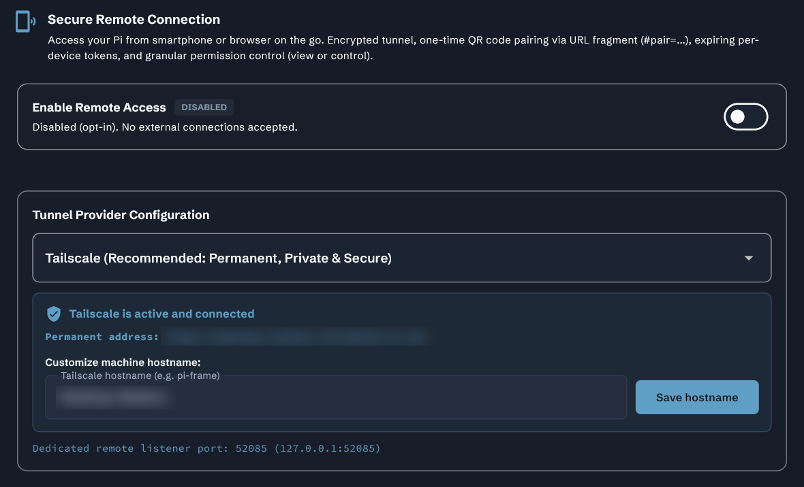
</p>

### Other details
- **Agent task list** that updates as the agent plans and completes steps.
- **MCP servers:** see configured servers and their tools, and turn servers on or off.
- **Instruction files:** view, edit, or generate `AGENTS.md` with the agent.
- **Sessions sidebar** grouped by repository, with search and pinned sessions; a welcome screen with your recent sessions.
- **Command palette** (`Ctrl+K` / `Cmd+K`).
- **Desktop notifications** when a long turn finishes or the agent needs your input.
- **Update check** for PiFrame and Pi, and first-run help to install Pi if it is missing.
- **Window position and size** are restored on the next launch.

---

## Download and install

Download the installer for your system from [**GitHub Releases**](https://github.com/TrentiStefano/PiFrame/releases/latest):

| System | Architecture | File | Notes |
| :--- | :--- | :--- | :--- |
| **Windows** | x64 | `PiFrame-Setup-<version>-windows-x64.exe` | Per-user install, no admin rights |
| **macOS** | Apple Silicon | `PiFrame-<version>-macos-arm64.dmg` | Drag to Applications; see the "How to open" note in the DMG |
| **macOS** | Intel | `PiFrame-<version>-macos-x64.dmg` | Same as above |
| **Linux** | x64 (Debian / Ubuntu) | `PiFrame-<version>-linux-amd64.deb` | `sudo apt install ./PiFrame-<version>-linux-amd64.deb` |

The installers include the PiFrame app, `pi-agentd` and the Node.js runtime it needs. You only need Pi itself.

### Requirements

1. **Pi Coding Agent 0.85.0 or later** on your `PATH`:
   ```bash
   npm install -g @earendil-works/pi-coding-agent
   pi --version
   ```
2. **A model provider** configured in Pi (for example with `/login`).

The full guide, in Italian, is in [docs/install.md](docs/install.md).

### Recommended Pi packages

PiFrame works without these packages. Install the packages for the agent features you want to use.

#### For PiFrame agent features

| Package | Feature | Install command |
| :--- | :--- | :--- |
| [rpiv-ask-user-question](https://pi.dev/packages/@juicesharp/rpiv-ask-user-question?name=rpiv-ask) | Structured questions and answers. | `pi install npm:@juicesharp/rpiv-ask-user-question` |
| [pi-subagents](https://pi.dev/packages/@tintinweb/pi-subagents?name=subagents) | Specialized subagents and orchestration. | `pi install npm:@tintinweb/pi-subagents` |
| [rpiv-todo](https://pi.dev/packages/@juicesharp/rpiv-todo?name=rpiv%20todo) | Agent task lists and progress. | `pi install npm:@juicesharp/rpiv-todo` |

#### Optional additions

| Package | Feature | Install command |
| :--- | :--- | :--- |
| [pi-mcp-adapter](https://pi.dev/packages/pi-mcp-adapter) | Connect to MCP servers and discover their tools. | `pi install npm:pi-mcp-adapter` |
| [pi-web-access](https://pi.dev/packages/pi-web-access) | Web search and content retrieval for the agent. | `pi install npm:pi-web-access` |
| [pi-caveman](https://pi.dev/packages/pi-caveman) | Concise agent responses. | `pi install npm:pi-caveman` |
| [ponytail](https://pi.dev/packages/@dietrichgebert/ponytail) | Coding guidance and review skills. | `pi install npm:@dietrichgebert/ponytail` |

Run only the install commands for the packages you need. Then restart the Pi session in PiFrame or run `/reload`.
Pi installs these packages in its own configuration. They can also affect your Pi terminal sessions.

Review third-party packages before installing them. MCP access also requires configured servers.
Installing `pi-mcp-adapter` can disable Pi's built-in MCP support and replace it with the adapter.
PiFrame uses Pi's RPC mode, so some terminal-only package interfaces are unavailable.

---

## Build from source

### 1. Clone & Install Dependencies
```bash
# Clone the repository
git clone https://github.com/TrentiStefano/PiFrame.git
cd PiFrame

# Install monorepo dependencies
pnpm install

# Build protocol packages and daemon bundle
pnpm build:all
```

### 2. Start the Daemon (`pi-agentd`)
```bash
# Production mode (connects to your real 'pi' CLI)
pnpm run:daemon

# Or local development mode (no LLM API key needed, uses fake-pi)
# On Windows PowerShell:
$env:PI_FRAME_PI_PATH = "$PWD/tools/fake-pi/dist/index.js"; pnpm run:daemon

# On macOS / Linux:
PI_FRAME_PI_PATH="$PWD/tools/fake-pi/dist/index.js" pnpm run:daemon
```

### 3. Run the app
```bash
cd apps/pi_frame

# Run natively on your desktop platform:
flutter run -d windows   # or 'macos' / 'linux'

# Or build for web (served via daemon origin):
flutter build web --no-web-resources-cdn
```

---

## Architecture

```text
PiFrame app (Flutter: Windows, macOS, Linux; web build for remote access)
   │  PCP, PiFrame's local protocol: HTTP + WebSocket on 127.0.0.1, per-install token
   ▼
pi-agentd (Node.js background service)
   │  starts and supervises one Pi worker per session, logs their events,
   │  replays them when the window reconnects
   ▼
pi --mode rpc   (your own Pi install, one process per open session)
   │
   ▼
~/.pi/agent/sessions/   (session history, owned by Pi)
```

| Part | Does | Does not |
| :--- | :--- | :--- |
| **PiFrame app** | UI, layout, themes, diff and Git views | Run Pi sessions itself (it asks `pi-agentd`) |
| **pi-agentd** | Runs Pi workers, logs and replays session events, Git and file access for the workspace | Draw any UI |
| **Pi** | Models, tools, file changes, session history | Know that PiFrame exists (it is a normal RPC client) |

More detail: [docs/security.md](docs/security.md), [docs/pi-compatibility.md](docs/pi-compatibility.md), [docs/theming.md](docs/theming.md).

---

## Tests

```bash
# All TypeScript, protocol and Flutter tests
pnpm test

# Flutter tests only
cd apps/pi_frame && flutter test

# End-to-end tests with fault injection
pnpm test:e2e

# Smoke test against the real Pi CLI with a local mock model
pnpm smoke:real-pi
```

---

## Troubleshooting

See [docs/troubleshooting.md](docs/troubleshooting.md). Common topics:
- **White or empty window on Windows** with virtual display drivers (USB Mobile Monitor, IddSampleDriver, Spacedesk) or several GPUs.
- **Remote access:** pairing, Tailscale and Cloudflare tunnels, and the phone web app.

---

## Repository layout

```text
PiFrame/
├── apps/
│   ├── pi_frame/        # Flutter app (Windows, macOS, Linux, web)
│   └── agentd/          # pi-agentd background service (TypeScript / Node.js)
├── packages/
│   ├── pcp-spec/        # PCP protocol specification and JSON Schemas
│   ├── pcp-ts/          # Generated TypeScript types and validators
│   ├── pi_frame_protocol/  # Generated Dart types for the app
│   └── pi_frame_theme/  # Theme engine (JSON themes with inheritance)
├── website/             # Project website (GitHub Pages)
├── docs/                # Install, security, theming, troubleshooting, design evidence
├── tools/               # fake-pi, fault-proxy, codegen, packaging and showcase scripts
└── test/e2e/            # End-to-end tests
```

---

## License

PiFrame is free and open source under the [MIT License](LICENSE). The installers also ship third-party software (the Node.js runtime and a few npm packages bundled into `pi-agentd`); their licenses are listed in [THIRD_PARTY_NOTICES.md](THIRD_PARTY_NOTICES.md).

The music in the promo video is "Happy Beats – Business Moves Vol. 12" by Sascha Ende ([ende.app](https://ende.app)), licensed under [CC BY 4.0](https://creativecommons.org/licenses/by/4.0/).
