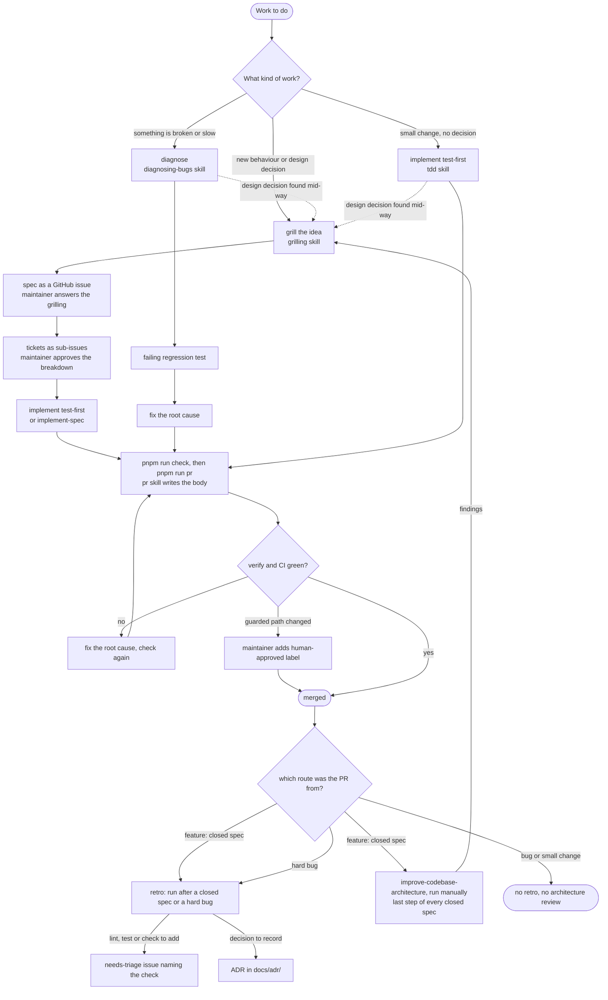

# Development workflow

This guide describes how work moves from an idea to a merged pull request in PiFrame. Agents and maintainers follow the
same routes. The reasons behind the routes are recorded in [ADR 0026](adr/0026-development-workflow.md).

The short version lives in [AGENTS.md](../AGENTS.md#workflow). This document holds the detail: when to use each route,
the skills and commands at each step, what the maintainer does, and how findings flow back.

## The three routes

Pick one route before you start. If you are unsure, pick the more careful one and move down only when the work is clearly
smaller.

| Route | Use it when | Steps |
| :--- | :--- | :--- |
| **Feature** | new behaviour, a UI change, or anything with a design decision | grill → spec → tickets → implement (or implement-spec) → `pnpm run pr` |
| **Bug** | something is broken, throws, fails or is slow | diagnose → failing regression test → fix → `pnpm run pr` |
| **Small change** | a change with no design decision and no bug (a rename, a copy fix, a small refactor) | implement test-first → `pnpm run pr` (no spec) |

A feature that turns out to be one small ticket still goes through grilling. A design decision found mid-way through a
small change moves that change to the feature route.

The loops in the flowchart are the only two feedback paths:

- **Retro loop.** `/retro` runs after a closed spec or a hard bug. Each finding becomes either a `needs-triage` issue that
  names the lint, test or check to add, or an ADR when the finding is a decision. A finding never becomes a new prose rule
  in AGENTS.md. The gate grows; the prose does not.
- **Architecture loop.** `improve-codebase-architecture` runs by hand as the last step of every closed spec. Its findings
  become specs, which start again at grilling. No background agent runs it, so no usage is spent on it unasked.

## Commands

| Command | What it does | When |
| :--- | :--- | :--- |
| `pnpm run check` | the inner loop: escape-hatch audit, doc link, map and timer checks, design lint, TypeScript and Dart analysis, all under the ratchets. It never installs. | after every small change |
| `pnpm run check -- <test file>` | `check` plus one test file, for example `tools/guardrails/test/steps.test.mjs` | while you work on a test |
| `pnpm run verify` | the full gate: the CI steps on the committed HEAD merged with `origin/main`, plus the golden screens on Windows | before a PR, after committing |
| `pnpm run pr` | checks the PR body, runs `verify`, pushes and opens the PR with `gh pr create` | to open a PR |
| `pnpm run test` / `pnpm run test:e2e` | all tests / end-to-end tests with fault injection | when a change touches behaviour across layers |
| `pnpm run goldens:update` | regenerates the golden screen references | only for an intended visual change |

Details of each check are in [pr-verification.md](pr-verification.md).

## Route 1: feature or design decision

1. **Grill.** Use the `grilling` skill to stress-test the idea until the design decisions are explicit. The agent asks
   questions; the maintainer answers them.
2. **Spec.** Write the spec as a GitHub issue. It states the problem, the solution, user stories, implementation decisions,
   testing decisions and what is out of scope.
3. **Tickets.** Split the spec into tickets, filed as sub-issues. Each ticket fits one agent session and one PR.
4. **Implement.** Work each ticket with the `tdd` skill (failing test first, then the change). `implement-spec` runs the
   tickets of one spec in order when the maintainer wants that.
5. **Check.** `pnpm run check` after every small change; `pnpm run check -- <test file>` for the test you are writing.
6. **Open the PR.** `pnpm run pr`. The `pr` skill writes the body: linked issue, summary, evidence, merge danger, guardrail
   changes.
7. **Review and close.** When the spec's tickets are merged, the architecture review runs (see the architecture loop) and
   `/retro` runs on the spec.

### Maintainer's part in a feature

- Answers the grilling questions. Nothing is specified until these answers exist.
- Approves the ticket breakdown before implementation starts.
- Adds the `human-approved` label when a PR changes a guardrail. The label is one click and expires on the next push, so
  approve only the final state of the PR.

### Worked example: a session pin toggle

The idea is to let users pin a session to the top of the sessions rail. The agent grills the idea: is the pin per device or
synced over the daemon, what happens to pinned sessions on restart, is it a feature the protocol must carry? The maintainer
answers; the answers become the spec issue. The spec splits into three tickets: the protocol field (schema first, then
`pnpm run codegen`), the daemon store, and the rail widget with its test. Each ticket is implemented test-first and opened
as its own PR with `pnpm run pr`. When the last ticket merges, the architecture review runs and `/retro` is recorded.

## Route 2: bug

`/bugfix <description>` (the `bugfix` skill, `.agents/skills/bugfix/SKILL.md`) runs this whole route from a bug report:
it opens the issue and the branch, diagnoses, writes the failing test, fixes, and opens the PR with `pnpm run pr`. It
stops only for a decision that is the maintainer's, and never merges.

1. **Diagnose.** Use the `diagnosing-bugs` skill. It builds a feedback loop first, then narrows the cause to one
   function or one data path. Write down what you observed.
2. **Failing regression test.** Write the test that fails for the bug, at the lowest level that reproduces it. Run it and
   see it fail with the reported symptom.
3. **Fix.** Fix the root cause, not the symptom. A type escape or a lint suppression is never the fix (see
   [escape hatches](../GLOSSARY.md#development)).
4. **Check and open the PR.** `pnpm run check`, then `pnpm run pr`. The regression test stays in the PR: every fixed bug
   leaves a test behind.
5. **Recurring pattern.** If the same mistake could come back in other places, add a lint or a gate check instead of a test
   only. Record the check in the PR.

### Worked example: a crash on an empty session list

The rail throws when the daemon returns zero sessions. Diagnosis shows the list widget reads the first element before it
checks the length. The regression test builds the rail with an empty list in the widget test and fails with the same
exception. The fix checks the length first. The PR contains the test and the one-line fix. If `/retro` later finds three
other widgets with the same pattern, the finding becomes a `needs-triage` issue for a lint, not a note in AGENTS.md.

## Route 3: small change

No spec and no grilling. The change has no design decision, so the route is short on purpose.

1. Write the failing test first when the change alters behaviour (`tdd`). A pure text or formatting change needs no new test;
   the existing suite and the goldens cover it.
2. Make the change. Keep it to one concern.
3. `pnpm run check`, then `pnpm run pr`.

If a design question appears during the change, stop and take the feature route instead.

### Worked example: a label correction

A settings label reads "Gateway" where the product uses "Daemon". The change edits the English string in
`apps/pi_frame/lib/data/language/`, runs `pnpm run check`, and opens the PR with `pnpm run pr`. A golden screen changes,
so the PR needs `pnpm run goldens:update` and the `human-approved` label; the maintainer reviews the changed images in
the PR's Files changed view before approving.

## Guardrails and approval

Some files are guarded paths: the analyzer and TypeScript configurations, the gate's own code and steps, the workflows,
the golden reference images, the escape-hatch and diagnostics baselines (raising a count), and AGENTS.md. A PR that
changes one of them fails the `Guardrail approval` check until the maintainer adds `human-approved`. The full list is in
[pr-verification.md](pr-verification.md#guardrail-approval). Lowering a baseline number never needs approval.

Agents do not add the label and do not weaken a guardrail to pass a check. If a guardrail blocks correct work, the agent
says so in the PR's Guardrail changes section and waits for the maintainer.

## Retro and architecture review

- **`/retro`** runs after each closed spec and after each hard bug. Its findings go in one of two places: a `needs-triage`
  issue naming the lint, test or check to add, or an ADR in `docs/adr/` for a decision. Never a new rule in AGENTS.md.
- **`improve-codebase-architecture`** runs manually as the last step of every closed spec. Its findings become specs.
  It is not scheduled.

## Where decisions live

- Design decisions: `docs/adr/`, in the existing ADR format (status, confirmation date, context, decision,
  consequences). The methodology decisions are in [ADR 0026](adr/0026-development-workflow.md).
- Terms: [GLOSSARY.md](../GLOSSARY.md). Use the term it gives, not the aliases it lists to avoid.
- Documentation rules: AGENTS.md rule 4 says where each kind of document goes. English only.
